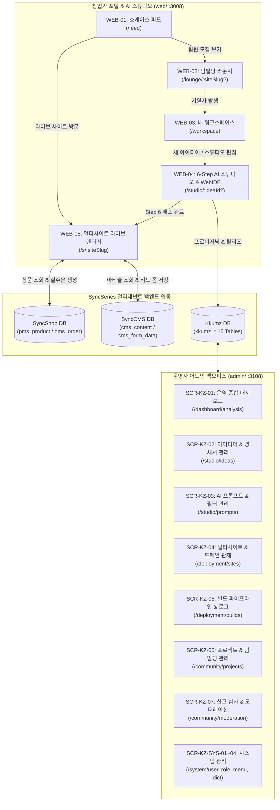

# Kkumz (꿈즈) — 신규 참여자를 위한 실무 온보딩 가이드

> **환영합니다!** 이 문서는 Kkumz 프로젝트에 처음 합류한 **기획자(PM), 디자이너, 프론트엔드/백엔드 개발자, QA 및 운영자**가 수백 페이지의 상세 명세서를 읽기 전에 **"딱 15분 만에 Kkumz가 어떻게 돌아가는지"** 큰 그림을 잡을 수 있도록 돕는 **첫날 가이드북(Day 1 Guidebook)**입니다.

---

## 1. 3분 만에 이해하는 Kkumz

### 1.1 우리가 해결하는 문제
- **창업가의 현실**: 번뜩이는 커머스나 브랜드 아이디어가 떠올라도, **네이밍 → 로고 제작 → 기획서 작성 → 쇼핑몰/웹사이트 구축 → 함께할 개발자·디자이너 구인**까지 최소 수개월과 수천만 원의 초기 비용이 소요됩니다.
- **기존 노코드 툴의 한계**: 정적 랜딩페이지는 만들어주지만 실제 상품 결제·재고(`SyncShop`)나 아티클·사전예약 폼(`SyncCMS`) 백엔드가 연결되지 않으며, AI가 만든 화면을 개발자가 코드 레벨에서 수정하거나 팀원을 모으는 기능이 단절되어 있습니다.
- **Kkumz의 해답**:
  1. **아이디어 한 줄 → 6단계 AI 스튜디오**: 네이밍 8종 + 벡터 SVG 로고 6종 + 마크다운 기능명세서 + 화면 블루프린트를 5분 안에 완성합니다.
  2. **2-Track 하이브리드 배포 + 실데이터 연동**: 노코드 즉시 배포(`DYNAMIC_SDUI`)와 브라우저 내장 WebIDE 커스텀 코드 빌드(`CUSTOM_BUNDLE` + AI 빌드 에러 자동 패치)를 모두 지원하며, 배포 즉시 **SyncShop 커머스 백엔드 및 SyncCMS 콘텐츠 백엔드**와 연결된 라이브 사이트(`/s/:siteSlug`)가 열립니다.
  3. **쇼케이스 피드 & 팀빌딩 라운지**: 배포된 라이브 사이트와 기능명세서를 투명하게 공개하여 초기 팬덤의 피드백을 받고, 함께 성장할 개발자·디자이너·마케터·MD 팀원을 즉시 모집합니다.

### 1.2 핵심 타깃 페르소나 4유형
| 페르소나 | 대표 시드 계정 (`03_seed_system.sql`) | 대표 프로젝트 (`05_sample_dev.sql`) | 핵심 니즈 |
| :--- | :--- | :--- | :--- |
| **로컬 스페셜티 브랜드 창업가** | `soyeon.jeju` (한소연 대표) | **말차 아뜰리에 제주** (`/s/matcha-atelier`, `COMMERCE`, `CUSTOM_BUNDLE`) | 프리미엄 브랜드 로고·컬러 구축, 정기구독 커머스 스토어 오픈, 디자이너·마케터 영입 |
| **하드웨어·데스크테리어 메이커** | `minjun.maker` (박민준 메이커) | **데스크 오빗** (`/s/desk-orbit`, `COMMERCE`, `DYNAMIC_SDUI`) | 모듈형 맥세이프 액세서리 즉시 스토어 오픈, 실물 주문 접수, 프론트엔드 개발자 영입 |
| **버티컬 커뮤니티 크루장** | `jihoon.run` (정지훈 크루장) | **서울 나이트 런 클럽** (`/s/seoul-run-club`, `CMS_SITE`, `DYNAMIC_SDUI`) | 야간 러닝 코스 매거진 발행, 크루 참가 신청 폼 접수, 콘텐츠 에디터 영입 |
| **F&B O2O 마이크로 로스터리** | `hajun.roast` (최하준 헤드로스터) | **빈 크로니클 서울** (`/s/bean-chronicle`, `HYBRID`, `CUSTOM_BUNDLE`) | 로스팅 노트 아티클(CMS) + 원두 드립백 판매(Shop) 결합 하이브리드 사이트 구축 |

---

## 2. 한눈에 보는 전체 화면 지하철 노선도 (User Web 5 + Admin 7 + System 4)

---

## 3. 반드시 알아야 할 3대 핵심 아키텍처 메커니즘

### 3.1 집중형 6-Step AI 스튜디오 상태 머신 (`kkumz_idea`)
창업 아이디어(`kkumz_idea`)는 `current_step` (1~6)과 `status` (`DRAFT` → `SPEC_READY` → `DEPLOYED`)를 가지며, 모든 단계의 생성물은 즉시 DB에 영속화됩니다.
- **Step 1 (아이디어 스케치)**: `title`, `summary`, `problem_statement`, `target_audience`, `site_type` (`COMMERCE` | `CMS_SITE` | `HYBRID`) 저장
- **Step 2 (AI 네이밍 8종)**: `POST /api/v1/kkumz/ideas/{id}/generate-names` → `kkumz_name_suggestion`에 8개 후보 저장 및 `/s/{slug}` 실시간 가용성 검증
- **Step 3 (AI 벡터 SVG 로고 6종)**: `POST /api/v1/kkumz/ideas/{id}/generate-logos` → `kkumz_logo_suggestion`에 순수 벡터 `<svg>` 코드와 5대 디자인 토큰(`primary`, `secondary`, `accent`, `surface`, `radius`) 저장
- **Step 4 (AI 기능명세서 및 버전 롤백)**: `POST /api/v1/kkumz/ideas/{id}/generate-spec` → 마크다운 명세서 생성 및 `kkumz_idea_version`에 스냅샷(`v1`, `v2`...) 보관, 언제든 이전 버전으로 롤백 가능
- **Step 5 (화면 블루프린트)**: `POST /api/v1/kkumz/ideas/{id}/generate-screens` → `kkumz_screen_spec`에 라우트별 섹션 블록 정의
- **Step 6 (2-Track 배포 & WebIDE)**: `POST /api/v1/kkumz/ideas/{id}/deploy` → `kkumz_site` 및 `kkumz_site_release` 생성

### 3.2 2-Track 하이브리드 배포 엔진 (`DYNAMIC_SDUI` vs `CUSTOM_BUNDLE`)
- **Track 1 — `DYNAMIC_SDUI` (즉시 노코드 배포)**:
  - 별도 번들 컴파일 없이 `kkumz_site_release.layout_schema_json`과 `design_tokens_json`을 `LiveSiteRendererView.vue`가 런타임에 해석하여 즉시 렌더링합니다.
- **Track 2 — `CUSTOM_BUNDLE` (WebIDE 커스텀 코드 배포 & AI 빌드 힐러)**:
  - 메이커나 합류한 개발자(`DEVELOPER`)가 스튜디오 내장 WebIDE에서 `HeroSection.vue`, `CustomStyles.css`, `site.config.json`을 직접 커스터마이징합니다.
  - 만약 문법 오류(예: `<template>` 닫는 태그 누락 등)로 샌드박스 빌드가 `FAILED`되면, **AI 에러 자동 패치(`POST /api/v1/kkumz/sites/{siteSlug}/webide-ai-fix`)**가 에러 로그를 분석하여 코드를 자동 교정하고 새 릴리즈(`v2`, `v3`)로 재빌드·배포합니다.

### 3.3 SyncShop & SyncCMS 크로스 DB 멀티테넌트 프로비저닝
Kkumz에서 사이트가 배포되면 `kkumz_site` 테이블의 `shop_site_id`와 `cms_site_id`가 매핑됩니다.
- `GET /api/v1/kkumz/sites/{siteSlug}/live` 호출 시:
  - `shop_site_id`가 존재하면 `sync_shop.pms_product`에서 해당 브랜드의 실제 판매 상품을 조회합니다 (`COMMERCE`, `HYBRID`).
  - `cms_site_id`가 존재하면 `sync_cms.cms_content`에서 브랜드 스토리·매거진 아티클을 조회합니다 (`CMS_SITE`, `HYBRID`).
- 라이브 사이트 방문자가 상품을 구매하면 `POST /api/v1/kkumz/sites/{siteSlug}/orders`가 `sync_shop.oms_order` 및 `oms_order_item`에 실제 주문을 기록하고 창업가에게 실시간 인앱 알림(`COMMERCE_ORDER`)을 보냅니다.

---

## 4. 직군별 필독 문서 패스트트랙 (Role Fast-Track)

본인의 역할에 맞춰 아래 순서대로 문서를 읽으면 가장 빠르게 업무에 투입될 수 있습니다.

| 직군 | 1순위 필독 문서 | 2순위 필독 문서 | 3순위 참조 문서 |
| :--- | :--- | :--- | :--- |
| **서비스 기획자 (PM)** | [`01_Kkumz_서비스_개발기획서.md`](./doc/01_Kkumz_서비스_개발기획서.md) | [`04_Kkumz_구현화면목록.md`](./doc/04_Kkumz_구현화면목록.md) [`05_Kkumz_화면별상세명세서.md`](./doc/05_Kkumz_화면별상세명세서.md) | [`06_Kkumz_기능명세서_및_멀티사이트아키텍처.md`](./doc/06_Kkumz_기능명세서_및_멀티사이트아키텍처.md) |
| **UI/UX 디자이너** | [`03_Kkumz_UIUX_디자인시스템_및_스타일가이드.md`](./doc/03_Kkumz_UIUX_디자인시스템_및_스타일가이드.md) | [`04_Kkumz_구현화면목록.md`](./doc/04_Kkumz_구현화면목록.md) | [`doc/screens/`](./doc/screens/) 개별 화면 명세서 |
| **프론트엔드 개발자** | [`02_Kkumz_사용자역할정의_및_권한체계.md`](./doc/02_Kkumz_사용자역할정의_및_권한체계.md) | [`03_Kkumz_UIUX_디자인시스템_및_스타일가이드.md`](./doc/03_Kkumz_UIUX_디자인시스템_및_스타일가이드.md) [`05_Kkumz_화면별상세명세서.md`](./doc/05_Kkumz_화면별상세명세서.md) | [`07_Kkumz_데이터모델링_및_인터페이스정의서.md`](./doc/07_Kkumz_데이터모델링_및_인터페이스정의서.md) |
| **백엔드 / AI 엔지니어** | [`07_Kkumz_데이터모델링_및_인터페이스정의서.md`](./doc/07_Kkumz_데이터모델링_및_인터페이스정의서.md) | [`08_Kkumz_기술연동_및_AI프롬프트_명세서.md`](./doc/08_Kkumz_기술연동_및_AI프롬프트_명세서.md) [`ai/00_AI_Agentization_Plan.md`](./doc/ai/00_AI_Agentization_Plan.md) | [`06_Kkumz_기능명세서_및_멀티사이트아키텍처.md`](./doc/06_Kkumz_기능명세서_및_멀티사이트아키텍처.md) |
| **QA / 서비스 운영자** | [`09_Kkumz_초기_시드데이터_및_테스트시나리오.md`](./doc/09_Kkumz_초기_시드데이터_및_테스트시나리오.md) | [`10_Kkumz_서비스_운영매뉴얼_및_SOP.md`](./doc/10_Kkumz_서비스_운영매뉴얼_및_SOP.md) | [`11_Kkumz_상용오픈_및_환경설정_가이드.md`](./doc/11_Kkumz_상용오픈_및_환경설정_가이드.md) |

---

## 5. 첫날 로컬 실행 및 E2E 체험 체크리스트

1. `docker compose -f docker-compose-local.yml up -d`로 PostgreSQL 18.6, Redis, MinIO 기동
2. `Server/kkumz-server-admin` Spring Boot 애플리케이션(`local` 프로파일, 포트 `8096`) 실행
3. `web/` (`http://localhost:3008`) 접속:
   - `/feed`에서 **말차 아뜰리에 제주**, **데스크 오빗**, **서울 나이트 런 클럽**, **빈 크로니클 서울** 4개 라이브 사이트 쇼케이스 확인
   - `/s/matcha-atelier` 클릭하여 라이브 멀티사이트에서 말차 상품 장바구니 담기·실제 주문 생성 및 우측 하단 **AI 브랜드 컨시어지** 대화 테스트
   - `/studio/idea-kkumz-001` 접속하여 6-Step AI 스튜디오, 버전 롤백, WebIDE 코드 편집 및 AI 에러 자동 패치 체험
4. `admin/` (`http://localhost:3108`) 접속 후 `admin` / `123456` 로그인:
   - 대시보드(`/dashboard/analysis`), 아이디어 관리(`/studio/ideas`), AI 프롬프트 관리(`/studio/prompts`), 멀티사이트 관제(`/deployment/sites`), 빌드 로그(`/deployment/builds`), 신고 모더레이션(`/community/moderation`) 화면 동작 확인
