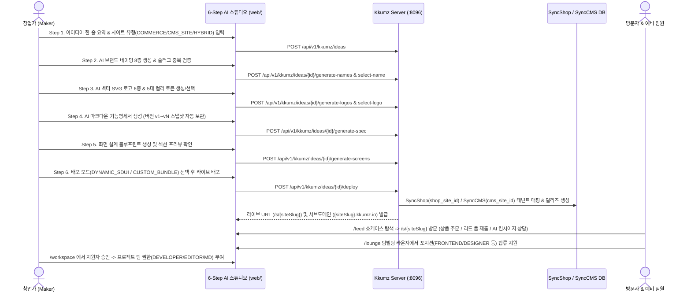

# DOC-KZ-01. Kkumz (꿈즈) 서비스 개발기획서

- **문서 번호**: DOC-KZ-01
- **대상 서비스**: `services/kkumz` (Kkumz AI 브랜드·웹사이트 빌더 및 창업 팀빌딩 플랫폼)
- **버전**: v2.6.5

---

## 1. 서비스 비전 및 기획 배경

### 1.1 기획 배경
초기 창업가, 1인 메이커, 로컬 브랜드 기획자가 아이디어를 실제 비즈니스 웹사이트로 런칭하기까지는 높은 진입 장벽이 존재합니다.
1. **브랜딩 및 기획 병목**: 브랜드 네이밍, 도메인(슬러그) 확보, 벡터 로고 제작, 컬러 시스템 정의, 화면 설계 및 기능명세서 작성에 수주 이상의 시간이 소요됩니다.
2. **껍데기만 존재하는 웹사이트 빌더의 한계**: 기존 AI 랜딩페이지 생성 도구들은 정적 HTML/이미지만 생성할 뿐, 실제 상품을 판매하고 주문을 처리하는 **커머스 백엔드(`SyncShop`)** 나 브랜드 매거진 발행·사전예약 리드를 수집하는 **콘텐츠 백엔드(`SyncCMS`)** 와 연결되지 않습니다.
3. **노코드와 프로코드(Pro-Code)의 단절**: 비개발자 창업가는 노코드로 빠르게 사이트를 열고 싶어 하지만, 이후 개발자가 팀에 합류했을 때 Vue SFC 코드를 직접 수정하고 빌드·배포할 수 있는 확장 경로가 막혀 있습니다.
4. **초기 팀빌딩 및 시장 검증의 파편화**: 사이트 런칭 후 초기 사용자로부터 피드백을 받고 함께할 개발자·디자이너·마케터·MD를 구하기 위해 별도의 채용/커뮤니티 플랫폼을 전전해야 합니다.

### 1.2 Kkumz의 핵심 가치 제안
> **"아이디어 한 줄에서 시작해 5분 만에 브랜드·기능명세서·실제 작동하는 커머스/CMS 멀티사이트를 런칭하고, 쇼케이스 피드에서 동료 팀원까지 영입하는 올인원 AI 창업 스튜디오"**

- **End-to-End 6-Step AI 스튜디오**: 아이디어 스케치 → AI 브랜드 네이밍(8종) & 슬러그 검증 → AI 벡터 SVG 로고(6종) & 디자인 토큰 → AI 마크다운 기능명세서 & 버전 히스토리 → 화면 설계 블루프린트 → 2-Track 하이브리드 배포까지 단일 스튜디오에서 완결합니다.
- **SyncShop & SyncCMS 실데이터 멀티테넌트 브릿지**: 사이트 유형(`COMMERCE`, `CMS_SITE`, `HYBRID`)에 따라 SyncShop(`pms_product`, `oms_order`) 및 SyncCMS(`cms_content`, `cms_form_data`) 멀티사이트 인스턴스를 즉시 프로비저닝합니다.
- **2-Track 하이브리드 배포 및 AI 빌드 힐러**: 비개발자를 위한 0초 즉시 배포(`DYNAMIC_SDUI`)와 개발자를 위한 WebIDE 커스텀 번들 배포(`CUSTOM_BUNDLE` + 빌드 실패 시 AI 에러 자동 패치)를 동시에 제공합니다.
- **창업 쇼케이스 피드 & 팀빌딩 라운지**: 배포된 라이브 사이트(`/s/:siteSlug`)와 기능명세서를 커뮤니티에 공개하여 실시간 좋아요·댓글 피드백을 받고, 포지션별 팀원을 모집·승인하여 프로젝트 공동 권한(`OWNER`, `EDITOR`, `DEVELOPER`, `MD`)을 부여합니다.

---

## 2. 핵심 타깃 페르소나 및 대표 유스케이스

| 구분 | 페르소나명 | 대표 시드 계정 | 문제 상황 | Kkumz를 통한 해결 및 산출물 |
| :--- | :--- | :--- | :--- | :--- |
| **P1** | **한소연 (29세)** 로컬 F&B 브랜드 창업가 | `soyeon.jeju` | 제주 유기농 첫물 차광 말차로 정기구독 브랜드를 열고 싶으나 로고 디자이너와 쇼핑몰 개발자가 없음 | **말차 아뜰리에 제주 (`/s/matcha-atelier`)** 생성. `COMMERCE` 유형 + `CUSTOM_BUNDLE` 배포로 SyncShop 말차 상품 4종 실주문 연동 및 브랜드 디자이너·마케터 모집 |
| **P2** | **박민준 (32세)** 하드웨어 1인 메이커 | `minjun.maker` | 알루미늄 CNC 맥세이프 데스크 오거나이저 시제품은 완성했으나 빠른 프리오더 스토어가 필요함 | **데스크 오빗 (`/s/desk-orbit`)** 생성. `COMMERCE` 유형 + `DYNAMIC_SDUI` 0초 즉시 배포로 프리오더 결제 오픈 후 WebIDE 3D 뷰어를 고도화할 프론트엔드 개발자 모집 |
| **P3** | **정지훈 (27세)** 러닝 크루 디렉터 | `jihoon.run` | 서울 야간 러닝 코스 아티클을 발행하고 매주 금요일 나이트 런 참가 신청을 받을 커뮤니티 사이트가 필요함 | **서울 나이트 런 클럽 (`/s/seoul-run-club`)** 생성. `CMS_SITE` 유형으로 SyncCMS 코스 아티클 3종 및 참가 신청 폼(`cms_form_data`) 연동, 콘텐츠 에디터 영입 |
| **P4** | **최하준 (34세)** 스페셜티 헤드로스터 | `hajun.roast` | 산지별 로스팅 아카이브 매거진(CMS)과 싱글오리진 원두·드립백 판매(Shop)를 한 사이트에 결합하고 싶음 | **빈 크로니클 서울 (`/s/bean-chronicle`)** 생성. `HYBRID` 유형으로 SyncShop 상품 + SyncCMS 아티클 동시 바인딩 및 커머스 MD 모집 |
| **P5** | **김서연 (31세)** 플랫폼 모더레이터 | `moderator.kim` | 사용자가 생성하는 수많은 사이트와 모집 공고 중 상표권 침해·피싱·허위 구인글을 신속히 차단해야 함 | 어드민 백오피스 **신고 심사 & 모더레이션 (`/community/moderation`)** 에서 신고 접수 건을 심사하고 원클릭으로 불량 사이트를 `SUSPENDED` 정지 처분 |

---

## 3. 엔드투엔드 사용자 여정 (6-Step AI 스튜디오 & 멀티사이트 라이프사이클)

---

## 4. 서비스 범위 (In-Scope vs Future Roadmap)

### 4.1 현재 구현 완료 범위 (v2.6.5 상용 기준)
1. **창업가 포털 & 6-Step AI 스튜디오 (`web/`)**:
   - 아이디어 생성·수정 및 6단계 순차/자유 이동 위저드
   - AI 브랜드 네이밍 8종 생성 및 `/s/{slug}` 실시간 중복 확인
   - AI 벡터 SVG 로고 6종 생성 및 브랜드 디자인 토큰(`primary`, `secondary`, `accent`, `surface`, `radius`) 추출
   - AI 마크다운 기능명세서 생성, 직접 편집, 버전 히스토리(`kkumz_idea_version`) 스냅샷 저장 및 원클릭 버전 롤백
   - 사이트 유형별 화면 블루프린트(`kkumz_screen_spec`) 자동 설계
   - `DYNAMIC_SDUI`(즉시 배포) 및 `CUSTOM_BUNDLE`(WebIDE SFC 편집 + 샌드박스 빌드 + AI 빌드 에러 자동 패치) 2-Track 배포
2. **멀티사이트 라이브 렌더러 (`/s/:siteSlug`)**:
   - SyncShop `pms_product` 실시간 조회 및 `oms_order` 실제 주문 생성
   - SyncCMS `cms_content` 아티클 조회 및 `cms_form_data` 고객 리드/사전예약 폼 제출
   - 사이트별 컨텍스트(기능명세서 + 판매 상품 + 아티클) 기반 **AI 브랜드 컨시어지 챗봇**
3. **커뮤니티 쇼케이스 피드 & 팀빌딩 라운지 (`/feed`, `/lounge`, `/workspace`)**:
   - 배포 사이트 쇼케이스 피드, 사이트 유형별 필터링, 좋아요 토글, 피드백 댓글 작성, 불량 사이트 신고
   - 포지션별 팀원 모집 공고 등록, 팀 합류 지원, 리더의 지원자 승인/반려, 실시간 인앱 알림 센터(`kkumz_notification`)
4. **운영자 어드민 백오피스 (`admin/`)**:
   - 종합 대시보드, 아이디어·명세서 원장 관리, AI 프롬프트 템플릿 및 금지어 관리, 멀티사이트 강제 정지/복구 관제, 빌드 파이프라인 로그 조회, 팀빌딩 프로젝트 관리, 신고 모더레이션 심사, 시스템 RBAC 관리

### 4.2 향후 확장 로드맵
- 외부 커스텀 도메인(CNAME) 자동 SSL 인증서(Let's Encrypt ACME) 프로비저닝 자동화 확장
- GitHub 양방향 저장소 동기화(Push/Pull Request) 연동
- 멀티사이트별 방문자 퍼널 및 전환율(CVR) 코호트 분석(SyncInsight 연동)

---

## 5. 핵심 성과 지표 (KPI)

| 지표 분류 | 측정 지표 | 산출 기준 | 목표치 |
| :--- | :--- | :--- | :--- |
| **스튜디오 전환율** | 아이디어 → 라이브 사이트 배포 전환율 | `DEPLOYED` 상태 아이디어 수 / 전체 생성 아이디어 수 | 65% 이상 |
| **빌드 안정성** | WebIDE 빌드 최종 성공률 (AI 자동 패치 포함) | `SUCCESS` 빌드 잡 수 / 전체 빌드 잡 수 | 98% 이상 |
| **멀티사이트 활성도** | 배포 사이트당 월간 실주문/리드 폼 발생 비율 | 실주문(`oms_order`) 또는 폼 제출(`cms_form_data`) 1건 이상 발생 사이트 비율 | 50% 이상 |
| **팀빌딩 매칭률** | 모집 공고 대비 팀원 합류 승인율 | `ACTIVE` 전환 팀원 수 / 전체 모집 공고 수 | 공고당 평균 1.5명 이상 |
| **모더레이션 SLA** | 신고 접수 후 심사 완료 평균 소요 시간 | `resolved_at - created_at` 평균 | 24시간 이내 |
