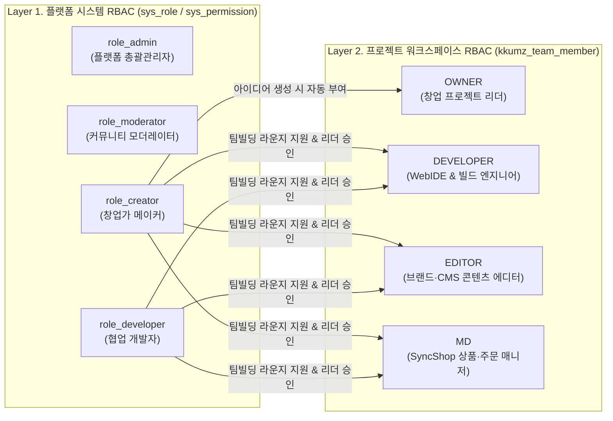

# DOC-KZ-02. Kkumz 사용자 역할 정의 및 권한 체계

- **문서 번호**: DOC-KZ-02
- **대상 서비스**: `services/kkumz` (`Server/kkumz-server-admin`, `admin/`, `web/`)
- **데이터베이스 원천**: `db/01_schema_system.sql`, `db/02_schema_domain.sql`, `db/03_seed_system.sql`, `db/04_seed_domain.sql`

---

## 1. 이중 권한 체계(Dual-Layer RBAC) 아키텍처 개요

Kkumz는 플랫폼 전체를 관할하는 **플랫폼 시스템 역할(`sys_role`)** 과 개별 창업 프로젝트/멀티사이트 단위의 협업을 제어하는 **프로젝트 팀 역할(`kkumz_team_member.role_code`)** 의 2계층 권한 체계를 운영합니다.

---

## 2. 플랫폼 시스템 역할 정의 (`sys_role`)

`db/03_seed_system.sql`에 정의된 4대 시스템 역할은 다음과 같습니다.

| 역할 ID (`sys_role.id`) | 역할 코드 (`role_code`) | 역할명 (`role_name`) | 주 접속 앱 | 권한 범위 요약 |
| :--- | :--- | :--- | :--- | :--- |
| `role_admin` | `role_admin` | 플랫폼 총괄관리자 | `admin/` (`:3108`) `web/` (`:3008`) | 어드민 백오피스 전체 도메인 메뉴(`SCR-KZ-01~07`) 및 시스템 관리 메뉴(`SCR-KZ-SYS-01~04`) 전체 접근, AI 프롬프트 수정, 멀티사이트 강제 정지 |
| `role_moderator` | `role_moderator` | 커뮤니티 모더레이터 | `admin/` (`:3108`) | 운영 종합 대시보드(`SCR-KZ-01`), 프로젝트 & 팀빌딩 관리(`SCR-KZ-06`), 신고 심사 & 모더레이션(`SCR-KZ-07`) 전담 접근 및 악성 사이트 정지 처분 |
| `role_creator` | `role_creator` | 창업가 메이커 | `web/` (`:3008`) | 아이디어 생성, 6-Step AI 스튜디오 실행, 멀티사이트 배포, 팀원 모집 공고 등록, 지원자 승인/반려 |
| `role_developer` | `role_developer` | 협업 개발자 | `web/` (`:3008`) | 팀빌딩 라운지 지원, 합류한 프로젝트의 WebIDE 소스코드 편집, 샌드박스 빌드 및 AI 빌드 패치 실행 |

---

## 3. 프로젝트 팀 역할 및 기능 권한 매트릭스 (`kkumz_team_member`)

개별 창업 프로젝트(`kkumz_idea` / `kkumz_site`) 내에서 팀원의 `role_code`(`OWNER`, `EDITOR`, `DEVELOPER`, `MD`) 및 합류 상태(`ACTIVE` / `PENDING`)에 따라 허용되는 작업 범위입니다.

| 기능 영역 | 세부 액션 | `OWNER` (창업 리더) | `DEVELOPER` (개발자) | `EDITOR` (콘텐츠/디자이너) | `MD` (커머스 매니저) | 일반 방문자 |
| :--- | :--- | :---: | :---: | :---: | :---: | :---: |
| **아이디어 & 기획** | Step 1~4 아이디어·네이밍·로고·기능명세서 편집 및 버전 롤백 | O | 열람 | O | 열람 | 공개본 열람 |
| **화면 & 테마** | Step 5 화면 블루프린트 및 브랜드 컬러 토큰(`design_tokens_json`) 수정 | O | O | O | X | X |
| **WebIDE & 빌드** | Step 6 WebIDE SFC 파일(`HeroSection.vue` 등) 편집 및 AI 에러 자동 패치 | O | O | X | X | X |
| **배포 & 도메인** | 멀티사이트 라이브 배포(`DYNAMIC_SDUI`/`CUSTOM_BUNDLE`) 및 도메인 설정 | O | O | X | X | X |
| **커머스 (`SyncShop`)** | 라이브 사이트 상품 구성 및 실주문(`oms_order`) 내역 확인 | O | X | X | O | 상품 구매 |
| **콘텐츠 (`SyncCMS`)** | 매거진 아티클(`cms_content`) 편집 및 고객 리드 폼(`cms_form_data`) 확인 | O | X | O | O | 아티클 열람·폼 제출 |
| **팀빌딩 관리** | 팀원 모집 공고 등록/마감 및 지원자 승인(`ACTIVE`)/반려 | O | X | X | X | 합류 지원(`PENDING`) |

---

## 4. 어드민 백오피스 DB 단일 원천 동적 라우팅 (`PermissionModeEnum.BACK`)

### 4.1 동적 라우팅 동작 원칙
1. `services/kkumz/admin/src/settings/projectSetting.ts`는 전사 표준에 따라 `permissionMode: PermissionModeEnum.BACK`으로 고정되어 있습니다.
2. 로그인 성공 직후 프론트엔드는 `GET /api/v1/kkumz/sys/permission/getUserPermissionByToken`을 호출하여 현재 사용자의 토큰(또는 `X-User-Name`)에 매핑된 `sys_permission` 메뉴 트리와 권한 코드 배열을 수신합니다.
3. 프론트엔드 내에 정적 라우트 파일(`router/routes/modules/*.ts`)을 두지 않으며, DB에서 반환된 `component` 경로를 기준으로 뷰 컴포넌트를 동적 임포트합니다.

### 4.2 `sys_permission` 전체 메뉴 트리 및 역할별 인가 매트릭스 (`03_seed_system.sql` & `04_seed_domain.sql`)

| 권한 ID (`sys_permission.id`) | 상위 ID | 메뉴명 (`name`) | 라우트 URL (`url`) | 뷰 컴포넌트 (`component`) | `menu_type` | 정렬 (`sort_no`) | `role_admin` | `role_moderator` |
| :--- | :--- | :--- | :--- | :--- | :---: | :---: | :---: | :---: |
| `perm-kkumz-sys-001` | `NULL` | 대시보드 | `/dashboard` | `LAYOUT` | `0` (폴더) | `1` | O | O |
| `perm-kkumz-sys-002` | `perm-kkumz-sys-001` | 운영 종합 대시보드 | `/dashboard/analysis` | `dashboard/analysis/index` | `1` (화면) | `1` | O | O |
| `perm-kkumz-dom-001` | `NULL` | AI 브랜드 스튜디오 | `/studio` | `LAYOUT` | `0` (폴더) | `10` | O | X |
| `perm-kkumz-dom-002` | `perm-kkumz-dom-001` | 아이디어 & 명세서 관리 | `/studio/ideas` | `studio/ideas/index` | `1` (화면) | `1` | O | X |
| `perm-kkumz-dom-003` | `perm-kkumz-dom-001` | AI 프롬프트 & 필터 관리 | `/studio/prompts` | `studio/prompts/index` | `1` (화면) | `2` | O | X |
| `perm-kkumz-dom-010` | `NULL` | 멀티사이트 & 빌드 관제 | `/deployment` | `LAYOUT` | `0` (폴더) | `20` | O | X |
| `perm-kkumz-dom-011` | `perm-kkumz-dom-010` | 멀티사이트 & 도메인 관제 | `/deployment/sites` | `deployment/sites/index` | `1` (화면) | `1` | O | X |
| `perm-kkumz-dom-012` | `perm-kkumz-dom-010` | 빌드 파이프라인 & 로그 | `/deployment/builds` | `deployment/builds/index` | `1` (화면) | `2` | O | X |
| `perm-kkumz-dom-020` | `NULL` | 커뮤니티 & 팀빌딩 | `/community` | `LAYOUT` | `0` (폴더) | `30` | O | O |
| `perm-kkumz-dom-021` | `perm-kkumz-dom-020` | 프로젝트 & 팀빌딩 관리 | `/community/projects` | `community/projects/index` | `1` (화면) | `1` | O | O |
| `perm-kkumz-dom-022` | `perm-kkumz-dom-020` | 신고 심사 & 모더레이션 | `/community/moderation` | `community/moderation/index` | `1` (화면) | `2` | O | O |
| `perm-kkumz-sys-010` | `NULL` | 시스템 관리 | `/system` | `LAYOUT` | `0` (폴더) | `90` | O | X |
| `perm-kkumz-sys-011` | `perm-kkumz-sys-010` | 사용자 계정 관리 | `/system/user` | `system/user/index` | `1` (화면) | `1` | O | X |
| `perm-kkumz-sys-012` | `perm-kkumz-sys-010` | 역할 및 권한 관리 | `/system/role` | `system/role/index` | `1` (화면) | `2` | O | X |
| `perm-kkumz-sys-013` | `perm-kkumz-sys-010` | 메뉴 및 라우트 관리 | `/system/menu` | `system/menu/index` | `1` (화면) | `3` | O | X |
| `perm-kkumz-sys-014` | `perm-kkumz-sys-010` | 공통 코드 관리 | `/system/dict` | `system/dict/index` | `1` (화면) | `4` | O | X |

---

## 5. 기본 시드 사용자 계정 명세 (`db/03_seed_system.sql`)

로컬 개발 및 통합 시연 환경에서 즉시 사용할 수 있는 6개 표준 시드 계정입니다 (초기 비밀번호 공통: `123456`).

| 사용자 ID (`sys_user.id`) | 로그인 ID (`username`) | 실명 (`realname`) | 부여된 시스템 역할 | 대표 소유 프로젝트 (`kkumz_idea` / `kkumz_site`) | 이메일 |
| :--- | :--- | :--- | :--- | :--- | :--- |
| `user_kkumz_admin` | `admin` | 김도현 총괄관리자 | `role_admin` | 플랫폼 전체 관제 | `admin@kkumz.io` |
| `user_kkumz_mod` | `moderator.kim` | 김서연 모더레이터 | `role_moderator` | 커뮤니티·신고 모더레이션 심사 전담 | `moderator@kkumz.io` |
| `user_kkumz_soyeon` | `soyeon.jeju` | 한소연 대표 | `role_creator` | 말차 아뜰리에 제주 (`idea-kkumz-001` / `/s/matcha-atelier`) | `soyeon@matcha-atelier.kr` |
| `user_kkumz_minjun` | `minjun.maker` | 박민준 메이커 | `role_creator` | 데스크 오빗 (`idea-kkumz-002` / `/s/desk-orbit`) | `minjun@deskorbit.io` |
| `user_kkumz_jihoon` | `jihoon.run` | 정지훈 크루장 | `role_creator` | 서울 나이트 런 클럽 (`idea-kkumz-003` / `/s/seoul-run-club`) | `jihoon@seoulrun.club` |
| `user_kkumz_hajun` | `hajun.roast` | 최하준 헤드로스터 | `role_creator` | 빈 크로니클 서울 (`idea-kkumz-004` / `/s/bean-chronicle`) | `hajun@beanchronicle.kr` |

---

## 6. 웹 포털 셀프 회원가입 및 소유권 기반 접근 제어 (Ownership RBAC)

### 6.1 셀프 회원가입 및 인증 세션 API (`KkumzSystemController`)
- **`POST /api/v1/kkumz/sys/register`**:
  - 신규 메이커/개발자 셀프 회원가입 엔드포인트.
  - 입력 필드: `username`(중복 검사), `password`(BCrypt 해싱 저장), `realname`, `email`, `phone`, `roleCode`(`ROLE_CREATOR` 기본값 또는 `ROLE_DEVELOPER`).
  - `sys_user` 및 `sys_user_role` 테이블에 트랜잭션으로 저장하며, 가입 즉시 `{ token, userInfo, roles }`를 반환하여 프론트엔드 자동 로그인을 수행합니다.
- **토큰 추출 일원화 (`KkumzSystemService.extractUsernameFromToken`)**:
  - `X-Access-Token` 및 `Authorization: Bearer ...` 헤더에서 현재 로그인 사용자(`username`)를 추출하여 `KkumzSystemController`와 `KkumzService` 전반에서 일관되게 사용합니다.

### 6.2 아이디어·사이트 소유권 검증 원칙 (`KkumzService`)
- **소유권 귀속**: `POST /api/v1/kkumz/ideas` 호출 시 비로그인 요청은 `HTTP 401`로 차단하며, 인증된 사용자의 `username`과 `realname`을 `kkumz_idea.author_username` / `author_display_name`에 귀속합니다.
- **편집 인가 판별 (`canEditIdea` / `canEditSite` / `assertIdeaEditable` / `assertSiteEditable`)**:
  1. **소유자 본인 (`isOwner = true`)**: `kkumz_idea.author_username == currentUser` 또는 `kkumz_site.owner_username == currentUser`
  2. **승인된 협업 팀원**: `kkumz_team_member.status = 'ACTIVE'` 이고 `member_role IN ('OWNER', 'DEVELOPER', 'EDITOR')`
  3. **플랫폼 총괄관리자**: `sys_user_role`에 `role_admin` 보유
- **타인 사이트 수정 원천 차단**:
  - 위 조건을 충족하지 않는 사용자가 타인의 아이디어/사이트에 대해 변경 API(기능 선택, 기획서 수정, AI 네이밍/로고 생성, 파일 업로드/삭제, 스캐폴딩, 채팅 리파인, WebIDE 저장, 빌드 패치, 사이트 배포/롤백, Git 프로비저닝/푸시/키회전, 팀원 모집 공고 등록, 지원자 승인/거절)를 호출할 경우 `GlobalExceptionHandler`를 통해 즉시 **`HTTP 403 Forbidden`** (비로그인 시 `HTTP 401 Unauthorized`)을 반환합니다.
- **프론트엔드 UI 격리 (`services/kkumz/web`)**:
  - 백엔드 조회 응답(`getCommunityFeed`, `getIdeaDetail`, `getSiteRuntime`, `listIdeas`)에 포함된 `canEdit`(boolean) 및 `isOwner`(boolean) 플래그를 기반으로, 본인이 수정 가능한 사이트에만 `내 사이트` 배지와 `[스튜디오 편집]` 버튼을 노출합니다.
  - 타인의 아이디어 URL(`/studio/:ideaId`)로 직접 접근 시 스튜디오 캔버스를 잠그고 소유권 보호 안내 화면을 표시합니다.
