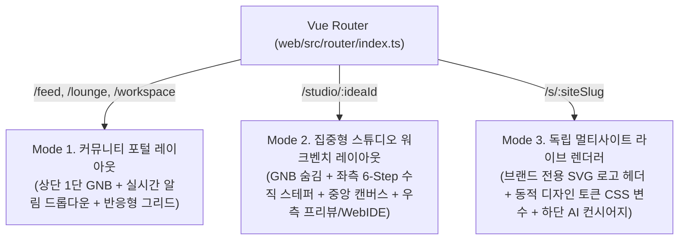

# DOC-KZ-03. Kkumz UI/UX 디자인 시스템 및 스타일 가이드

- **문서 번호**: DOC-KZ-03
- **대상 애플리케이션**:
  1. 창업가 포털 & 6-Step AI 스튜디오 & 멀티사이트 렌더러 (`services/kkumz/web/`)
  2. 운영자 어드민 백오피스 (`services/kkumz/admin/`)

---

## 1. 디자인 원칙 및 레이아웃 아키텍처

Kkumz는 하나의 웹 애플리케이션(`web/`) 안에서 **1) 창업가 커뮤니티 탐색**, **2) 고밀도 AI 스튜디오 & WebIDE 작업**, **3) 개별 브랜드의 독립 라이브 사이트 렌더링**이라는 세 가지 상이한 맥락을 처리합니다. 이를 위해 라우트 메타데이터(`route.meta.layout`) 기반의 **3-Mode 적응형 레이아웃 체계**를 적용합니다.



### 1.1 Mode 1: 커뮤니티 포털 레이아웃 (`/feed`, `/lounge`, `/workspace`)
- **글로벌 내비게이션 바 (GNB)**:
  - 좌측: `K` 심볼 로고 + `Kkumz Studio` 브랜드 타이틀 + `AI Brand & Multi-Site Builder` 서브 배지
  - 중앙(우측 정렬 탭): `쇼케이스 피드 (/feed)`, `팀빌딩 라운지 (/lounge)`, `내 워크스페이스 (/workspace)`
  - 우측 액션 영역: 실시간 미읽음 배지(`unreadCount`)가 포함된 **인앱 알림 센터 드롭다운** + `+ 새 아이디어 & 사이트 만들기 (/studio)` 프라이머리 CTA 버튼
- **최대 컨테이너 폭**: `max-width: 1280px` 중앙 정렬, 카드 그리드 간격 `20px ~ 24px`

### 1.2 Mode 2: 집중형 6-Step AI 스튜디오 워크벤치 (`/studio/:ideaId`)
- 스튜디오 진입 시(`route.meta.layout === 'studio'`) 상단 커뮤니티 GNB를 자동으로 숨겨 화면 세로 공간을 100% 확보합니다.
- **3-Pane 워크벤치 구조**:
  1. **좌측 고정 사이드바 (`260px`)**: 현재 프로젝트 타이틀, 사이트 유형 배지, Step 1~6 수직 스테퍼 내비게이션, 워크스페이스 복귀 링크
  2. **중앙 메인 워크스페이스 (`1fr`)**: 현재 단계의 입력 폼, AI 생성 트리거 버튼, 8종 네이밍/6종 SVG 로고 선택 그리드, 마크다운 기능명세서 에디터 및 버전 히스토리 타임라인
  3. **우측 라이브 프리뷰 / WebIDE 패널 (`420px ~ 520px`)**: 선택한 로고·컬러 토큰이 즉시 반영되는 실시간 미니 사이트 프리뷰 및 Step 6의 다크 테마 WebIDE 코드 편집기(`HeroSection.vue`, `CustomStyles.css`, `site.config.json`)

### 1.3 Mode 3: 독립 멀티사이트 라이브 렌더러 (`/s/:siteSlug`)
- 방문자가 `/s/matcha-atelier` 등에 접속하면 Kkumz 플랫폼 UI를 완전히 걷어내고, 해당 창업 브랜드의 독자적인 웹사이트로 렌더링합니다.
- **상단 브랜드 헤더**: AI가 생성한 순수 벡터 `<svg>` 로고 + 브랜드명 + 사이트 유형별 내비게이션 탭(커머스 스토어 / 브랜드 매거진 / 장바구니 카운터)
- **하단 플로팅 배지 및 AI 컨시어지**:
  - 좌측 하단: `Built with Kkumz AI Studio` 크레딧 배지 및 `스튜디오에서 복제/팀 합류` 바로가기
  - 우측 하단: 브랜드 대표 컬러(`primary`)가 적용된 **AI 브랜드 컨시어지 챗봇** 플로팅 버튼 및 대화창

---

## 2. 컬러 시스템 및 멀티사이트 동적 테마 토큰

### 2.1 Kkumz 플랫폼 기본 컬러 팔레트 (`web/` & `admin/`)
| 토큰 구분 | HEX 코드 | 용도 |
| :--- | :--- | :--- |
| **Platform Primary** | `#4F46E5` (Indigo 600) | 스튜디오 핵심 액션 버튼, 활성 탭, AI 생성 하이라이트 |
| **Platform Secondary** | `#7C3AED` (Violet 600) | 그라데이션 포인트(`linear-gradient(135deg, #4F46E5, #7C3AED)`), AI 배지 |
| **Surface / Background** | `#F8FAFC` (Slate 50) | 포털 기본 배경색 (카드 배경은 `#FFFFFF`) |
| **Dark IDE Surface** | `#0F172A` (Slate 900) | Step 6 WebIDE 코드 에디터 및 빌드 콘솔 터미널 배경 |
| **Text Primary / Secondary** | `#0F172A` / `#475569` | 본문 타이틀 및 보조 설명 텍스트 |
| **Semantic Status** | 성공 `#10B981`, 경고 `#F59E0B`, 오류 `#EF4444` | 빌드 성공(`SUCCESS`), 모더레이션 대기(`PENDING`), 빌드 실패/정지(`FAILED`/`SUSPENDED`) |

### 2.2 멀티사이트 동적 디자인 토큰 규격 (`design_tokens_json`)
Step 3(AI 벡터 로고 생성)에서 각 브랜드별로 추출되어 `kkumz_idea.design_tokens_json` 및 `kkumz_site_release.design_tokens_json`에 저장되는 5대 필수 토큰입니다.

```json
{
  "primary": "#1B4332",
  "secondary": "#40916C",
  "accent": "#D8F3DC",
  "surface": "#F8FBF9",
  "radius": "14px"
}
```

#### 대표 4대 샘플 멀티사이트 브랜드 테마 프리셋 (`db/05_sample_dev.sql`)
| 멀티사이트 (`site_slug`) | 브랜드명 | `primary` | `secondary` | `accent` | `surface` | `radius` | 디자인 무드 |
| :--- | :--- | :---: | :---: | :---: | :---: | :---: | :--- |
| `matcha-atelier` | 말차 아뜰리에 제주 | `#1B4332` | `#40916C` | `#D8F3DC` | `#F8FBF9` | `14px` | 다도·유기농 차밭의 딥 포레스트 그린 |
| `desk-orbit` | 데스크 오빗 | `#0F172A` | `#3B82F6` | `#DBEAFE` | `#F8FAFC` | `12px` | 아노다이징 알루미늄 & 테크 블루 |
| `seoul-run-club` | 서울 나이트 런 클럽 | `#111827` | `#10B981` | `#D1FAE5` | `#F9FAFB` | `16px` | 어반 나이트 애슬레저 & 네온 에메랄드 |
| `bean-chronicle` | 빈 크로니클 서울 | `#451A03` | `#B45309` | `#FEF3C7` | `#FFFBEB` | `10px` | 에스프레소 브라운 & 웜 앰버 크래프트 |

---

## 3. 타이포그래피 및 아이콘 시스템

- **기본 본문 서체**: `Pretendard Variable`, `-apple-system`, `BlinkMacSystemFont`, `system-ui`, `sans-serif`
- **WebIDE 코드 및 빌드 로그 서체**: `'JetBrains Mono'`, `'Fira Code'`, `Consolas`, `monospace`
- **벡터 로고 렌더링 원칙**:
  - Step 3에서 생성되는 모든 로고(`kkumz_logo_suggestion.svg_code`)는 외부 래스터 이미지(PNG/JPG)가 아닌 순수 인라인 `<svg viewBox="0 0 120 120">` 코드로 저장되어, 파비콘(`24px`)부터 히어로 배너(`240px`)까지 해상도 저하 없이 렌더링됩니다.

---

## 4. 운영자 어드민 백오피스 (`admin/`) Vben 표준 컴포넌트 규격

`services/kkumz/admin`의 모든 화면은 전사 프론트엔드 표준에 따라 원시 `<a-table>`, `<a-modal>`, `<a-form>` 직접 사용을 지양하고 Vben 고수준 컴포넌트로 구현합니다.

| UI 패턴 | 필수 사용 컴포넌트 (`/@/components/*`) | 적용 화면 예시 |
| :--- | :--- | :--- |
| **페이지 레이아웃** | `PageWrapper` (`/@/components/Page`) | 전 도메인 화면(`SCR-KZ-01` ~ `SCR-KZ-07`) 공통 래퍼 |
| **데이터 그리드** | `BasicTable`, `useTable`, `TableAction` (`/@/components/Table`) | 아이디어 목록(`studio/ideas`), 멀티사이트 관제(`deployment/sites`), 빌드 로그(`deployment/builds`), 신고 심사(`community/moderation`) |
| **상세/편집 모달** | `BasicModal`, `useModal`, `useModalInner` (`/@/components/Modal`) | `IdeaDetailModal.vue`, `PromptModal.vue`, `BuildLogModal.vue`, `ModerationResolveModal.vue` |
| **선언형 입력 폼** | `BasicForm`, `useForm` (`/@/components/Form`) | AI 프롬프트 수정 폼, 신고 심사 처분 입력 폼, 검색 필터 폼(`useSearchForm: true`) |
| **스키마 파일 분리** | 각 화면 폴더 내 `*.data.ts` (`columns`, `searchFormSchema`, `formSchema`) | `ideas.data.ts`, `prompts.data.ts`, `sites.data.ts`, `builds.data.ts`, `projects.data.ts`, `moderation.data.ts` |
