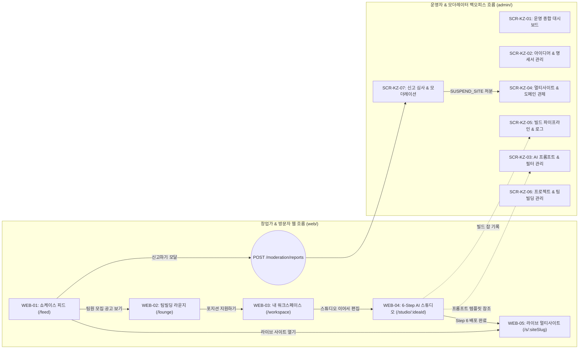

# DOC-KZ-04. Kkumz 구현 화면 목록 (Master Screen Matrix)

- **문서 번호**: DOC-KZ-04
- **대상 애플리케이션**:
  1. 창업가 포털 & 6-Step AI 스튜디오 & 멀티사이트 렌더러 (`services/kkumz/web/`, 포트 `3008`)
  2. 운영자 어드민 백오피스 (`services/kkumz/admin/`, 포트 `3108`)
- **원천 정합성 기준**: `web/src/router/index.ts`, `db/03_seed_system.sql`, `db/04_seed_domain.sql`

---

## 1. 전체 화면 구성 요약

| 애플리케이션 구분 | 화면 분류 | 화면 수 | 서브 모달/패널 수 | 라우팅 방식 |
| :--- | :--- | :---: | :---: | :--- |
| **사용자 웹 (`web/`)** | 창업가 포털 & AI 스튜디오 & 멀티사이트 렌더러 | **5개 뷰** (`WEB-01` ~ `WEB-05`) | 4개 (댓글/신고/지원/컨시어지) | Vue Router (`web/src/router/index.ts`) |
| **운영자 어드민 (`admin/`)** | 도메인 비즈니스 관제 화면 | **7개 화면** (`SCR-KZ-01` ~ `SCR-KZ-07`) | 4개 (`*Modal.vue`) | DB 동적 라우팅 (`PermissionModeEnum.BACK`) |
| **운영자 어드민 (`admin/`)** | 시스템 공통 RBAC/코드 관리 화면 | **4개 화면** (`SCR-KZ-SYS-01` ~ `04`) | 4개 (`*Modal.vue`) | DB 동적 라우팅 (`PermissionModeEnum.BACK`) |
| **합계** | **전체 구현 화면** | **16개 메인 화면** | **12개 서브 모달/패널** | - |

---

## 2. 창업가 포털 & AI 스튜디오 (`web/`) 화면 목록

| 화면 ID | 화면명 | 라우트 경로 (`path`) | 레이아웃 모드 (`meta.layout`) | 소스 파일 경로 (`services/kkumz/web/src/`) | 연동 REST API (`/api/v1/kkumz/...`) | 개별 명세서 |
| :---: | :--- | :--- | :---: | :--- | :--- | :--- |
| **WEB-01** | **쇼케이스 피드** | `/feed` (루트 `/` 리다이렉트) | `community` (1단 GNB) | `views/FeedView.vue` | `GET /feed` `POST /feed/{siteId}/like` `GET, POST /feed/{siteId}/comments` `POST /moderation/reports` | [`WEB-01`](./screens/WEB-01_쇼케이스_피드.md) |
| **WEB-02** | **팀빌딩 라운지** | `/lounge/:siteSlug?` | `community` (1단 GNB) | `views/ProjectLoungeView.vue` | `GET /recruits` `POST /recruits` `POST /recruits/{id}/apply` | [`WEB-02`](./screens/WEB-02_팀빌딩_라운지.md) |
| **WEB-03** | **내 워크스페이스** | `/workspace` | `community` (1단 GNB) | `views/WorkspaceView.vue` | `GET /ideas` `GET /sites` `GET /team-members` `POST /team-members/{id}/approve` `GET, POST /notifications` | [`WEB-03`](./screens/WEB-03_내_워크스페이스.md) |
| **WEB-04** | **6-Step AI 스튜디오 & WebIDE** | `/studio/:ideaId?` | `studio` (GNB 숨김, 3-Pane 워크벤치) | `views/StudioView.vue` | `GET, POST, PUT /ideas` `POST /ideas/{id}/generate-names` `POST /ideas/{id}/select-name` `POST /ideas/{id}/generate-logos` `POST /ideas/{id}/select-logo` `POST /ideas/{id}/generate-spec` `GET /ideas/{id}/versions` `POST /ideas/{id}/rollback` `POST /ideas/{id}/generate-screens` `POST /ideas/{id}/deploy` `POST /sites/{siteSlug}/webide-save` `POST /sites/{siteSlug}/webide-ai-fix` | [`WEB-04`](./screens/WEB-04_6단계_AI_스튜디오_및_WebIDE.md) |
| **WEB-05** | **멀티사이트 라이브 렌더러** | `/s/:siteSlug` | `independent` (독립 브랜드 사이트) | `views/LiveSiteRendererView.vue` | `GET /sites/{siteSlug}/live` `POST /sites/{siteSlug}/orders` `POST /sites/{siteSlug}/forms` `POST /sites/{siteSlug}/concierge` | [`WEB-05`](./screens/WEB-05_멀티사이트_라이브_렌더러.md) |

---

## 3. 운영자 어드민 백오피스 (`admin/`) 도메인 화면 목록

모든 어드민 화면은 `db/03_seed_system.sql` 및 `db/04_seed_domain.sql`의 `sys_permission` 테이블에 정의되어 있으며, `GET /api/v1/kkumz/sys/permission/getUserPermissionByToken`을 통해 동적 공급됩니다.

| 화면 ID | 권한 ID (`sys_permission.id`) | 상위 카테고리 | 화면명 (`name`) | 라우트 URL (`url`) | 뷰 컴포넌트 (`admin/src/views/`) | 분리된 스키마 & 모달 파일 | 접근 역할 | 개별 명세서 |
| :---: | :--- | :--- | :--- | :--- | :--- | :--- | :--- | :--- |
| **SCR-KZ-01** | `perm-kkumz-sys-002` | 대시보드 (`/dashboard`) | **운영 종합 대시보드** | `/dashboard/analysis` | `dashboard/analysis/index.vue` | - | `role_admin` `role_moderator` | [`SCR-KZ-01`](./screens/SCR-KZ-01_운영_종합_대시보드.md) |
| **SCR-KZ-02** | `perm-kkumz-dom-002` | AI 브랜드 스튜디오 (`/studio`) | **아이디어 & 명세서 관리** | `/studio/ideas` | `studio/ideas/index.vue` | `ideas.data.ts` `IdeaDetailModal.vue` | `role_admin` | [`SCR-KZ-02`](./screens/SCR-KZ-02_아이디어_및_명세서_관리.md) |
| **SCR-KZ-03** | `perm-kkumz-dom-003` | AI 브랜드 스튜디오 (`/studio`) | **AI 프롬프트 & 필터 관리** | `/studio/prompts` | `studio/prompts/index.vue` | `prompts.data.ts` `PromptModal.vue` | `role_admin` | [`SCR-KZ-03`](./screens/SCR-KZ-03_AI_프롬프트_및_필터_관리.md) |
| **SCR-KZ-04** | `perm-kkumz-dom-011` | 멀티사이트 & 빌드 관제 (`/deployment`) | **멀티사이트 & 도메인 관제** | `/deployment/sites` | `deployment/sites/index.vue` | `sites.data.ts` | `role_admin` | [`SCR-KZ-04`](./screens/SCR-KZ-04_멀티사이트_및_도메인_관제.md) |
| **SCR-KZ-05** | `perm-kkumz-dom-012` | 멀티사이트 & 빌드 관제 (`/deployment`) | **빌드 파이프라인 & 로그** | `/deployment/builds` | `deployment/builds/index.vue` | `builds.data.ts` `BuildLogModal.vue` | `role_admin` | [`SCR-KZ-05`](./screens/SCR-KZ-05_빌드_파이프라인_및_로그.md) |
| **SCR-KZ-06** | `perm-kkumz-dom-021` | 커뮤니티 & 팀빌딩 (`/community`) | **프로젝트 & 팀빌딩 관리** | `/community/projects` | `community/projects/index.vue` | `projects.data.ts` | `role_admin` `role_moderator` | [`SCR-KZ-06`](./screens/SCR-KZ-06_프로젝트_및_팀빌딩_관리.md) |
| **SCR-KZ-07** | `perm-kkumz-dom-022` | 커뮤니티 & 팀빌딩 (`/community`) | **신고 심사 & 모더레이션** | `/community/moderation` | `community/moderation/index.vue` | `moderation.data.ts` `ModerationResolveModal.vue` | `role_admin` `role_moderator` | [`SCR-KZ-07`](./screens/SCR-KZ-07_신고_심사_및_모더레이션.md) |

---

## 4. 운영자 어드민 백오피스 (`admin/`) 시스템 공통 화면 목록

| 화면 ID | 권한 ID (`sys_permission.id`) | 화면명 (`name`) | 라우트 URL (`url`) | 뷰 컴포넌트 (`admin/src/views/`) | 연동 REST API (`/api/v1/kkumz/sys/...`) | 접근 역할 |
| :---: | :--- | :--- | :--- | :--- | :--- | :--- |
| **SCR-KZ-SYS-01** | `perm-kkumz-sys-011` | **사용자 계정 관리** | `/system/user` | `system/user/index.vue` | `GET /sys/user/list` `POST, PUT /sys/user/save` `DELETE /sys/user/delete` | `role_admin` |
| **SCR-KZ-SYS-02** | `perm-kkumz-sys-012` | **역할 및 권한 관리** | `/system/role` | `system/role/index.vue` | `GET /sys/role/list` `POST, PUT /sys/role/save` `GET /sys/permission/queryRolePermission` `POST /sys/permission/saveRolePermission` | `role_admin` |
| **SCR-KZ-SYS-03** | `perm-kkumz-sys-013` | **메뉴 및 라우트 관리** | `/system/menu` | `system/menu/index.vue` | `GET /sys/permission/list` `POST, PUT /sys/permission/save` `DELETE /sys/permission/delete` | `role_admin` |
| **SCR-KZ-SYS-04** | `perm-kkumz-sys-014` | **공통 코드 관리** | `/system/dict` | `system/dict/index.vue` | `GET /sys/dict/list` `GET /sys/dictItem/list` `POST, PUT /sys/dict/save` | `role_admin` |

---

## 5. 화면 간 인터랙션 및 전환 흐름도

