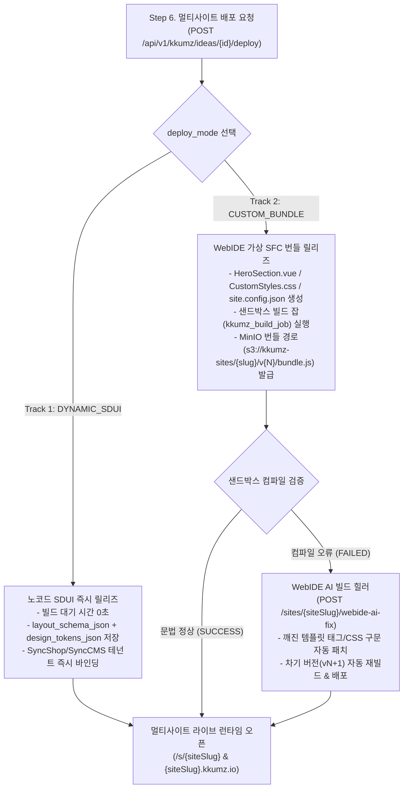

# DOC-KZ-06. Kkumz 기능명세서 및 멀티사이트 아키텍처

- **문서 번호**: DOC-KZ-06
- **대상 서비스**: `services/kkumz` (`Server/kkumz-server-admin`, `web/`, `admin/`)
- **핵심 소스**: `KkumzService.java`, `KkumzController.java`

---

## 1. 기능 도메인 구조 (7대 핵심 모듈)

| 모듈 코드 | 모듈명 | 관련 테이블 | 핵심 비즈니스 기능 |
| :---: | :--- | :--- | :--- |
| **MOD-01** | **아이디어 & 버전 관리 엔진** | `kkumz_idea` `kkumz_idea_version` | 아이디어 생성/수정, 6단계 진행 상태 관리, 마크다운 기능명세서 생성 및 버전 스냅샷(`v1`~`vN`) 비교·롤백 |
| **MOD-02** | **AI 네이밍 & 슬러그 검증기** | `kkumz_name_suggestion` `kkumz_site` | 한/영/혼합 브랜드 네이밍 8종 생성, 네이밍 스토리 해설, `/s/{slug}` 및 `{slug}.kkumz.io` 중복 검증 |
| **MOD-03** | **AI 벡터 SVG 로고 & 디자인 토큰** | `kkumz_logo_suggestion` | 심볼형·워드마크형·엠블럼형 순수 인라인 `<svg>` 로고 6종 생성 및 5대 디자인 토큰(`primary` 등) 추출 |
| **MOD-04** | **화면 블루프린트 설계기** | `kkumz_screen_spec` | 사이트 유형(`COMMERCE`, `CMS_SITE`, `HYBRID`) 맞춤 라우트 구조 및 섹션 블록 JSON 스키마 생성 |
| **MOD-05** | **2-Track 멀티사이트 배포 & WebIDE** | `kkumz_site` `kkumz_site_release` `kkumz_build_job` | `DYNAMIC_SDUI`(즉시 배포) 및 `CUSTOM_BUNDLE`(WebIDE SFC 편집, 샌드박스 빌드, AI 빌드 에러 자동 패치) |
| **MOD-06** | **SyncShop & SyncCMS 런타임 브릿지** | `sync_shop.pms_product` `sync_shop.oms_order` `sync_cms.cms_content` `sync_cms.cms_form_data` | 멀티사이트별 상품 목록 조회·실주문 생성, 매거진 아티클 조회·리드 폼 접수, AI 브랜드 컨시어지 챗봇 |
| **MOD-07** | **커뮤니티·팀빌딩·모더레이션** | `kkumz_feed_comment` `kkumz_feed_like` `kkumz_team_recruit` `kkumz_team_member` `kkumz_moderation_report` `kkumz_notification` | 쇼케이스 피드 좋아요/댓글, 포지션별 팀원 모집 및 합류 승인 워크플로우, 불량 사이트 신고 심사 및 강제 정지 |

---

## 2. 핵심 모듈별 상세 기능 명세

### 2.1 MOD-01 ~ 03: AI 브랜드 아이덴티티 및 기능명세서 버전 관리

#### 1) 브랜드 네이밍 8종 생성 및 슬러그 가용성 검증 (`generateBrandNames`)
- **입력**: `ideaId` (`kkumz_idea.title`, `summary`, `target_audience`, `site_type`)
- **처리 로직**:
  1. `kkumz_ai_prompt_template`의 `BRAND_NAMING_8X` 규칙 및 금지어 필터(`forbidden_words_json`)를 로드합니다.
  2. 프로젝트 도메인 키워드에서 기본 슬러그(`baseSlug`)를 추출하고, 미니멀·직관형·감성 스토리형·글로벌 확장형·모던 하이브리드·크리에이티브 랩·커뮤니티 크루·시그니처 에디션 등 8가지 다각도 브랜드명 후보와 추천 슬러그(`recommended_slug`)를 생성합니다.
  3. 각 추천 슬러그에 대해 `kkumz_site` 테이블에 동일 `site_slug`를 사용 중인 타 사이트가 존재하는지 실시간 조회하여 `slug_available` (`true`/`false`)을 기록합니다.
  4. 창업가가 특정 후보를 선택(`selectBrandName`)하면 `kkumz_idea.selected_brand_name`, `selected_site_slug`가 갱신되고 `current_step`이 최소 `3` 이상으로 전이됩니다.

#### 2) 벡터 SVG 로고 6종 및 디자인 토큰 생성 (`generateVectorLogos`)
- **입력**: 확정된 브랜드명(`selected_brand_name`) 및 사이트 유형
- **처리 로직**:
  1. 외부 이미지 URL에 의존하지 않는 순수 인라인 `<svg viewBox="0 0 120 120">` 벡터 그래픽 6종(딥 포레스트 & 골드, 모던 인디고 & 바이올렛, 에스프레소 크래프트, 어반 나이트 에메랄드, 코랄 선셋, 노르딕 슬레이트)을 생성합니다.
  2. 각 로고 후보마다 사이트 전체 UI 테마를 결정하는 5대 디자인 토큰(`primary`, `secondary`, `accent`, `surface`, `radius`)을 함께 생성하여 `kkumz_logo_suggestion.color_palette_json`에 저장합니다.
  3. 창업가가 로고를 선택(`selectLogo`)하면 `kkumz_idea.selected_logo_svg` 및 `design_tokens_json`에 즉시 반영됩니다.

#### 3) 마크다운 기능명세서 생성 및 버전 롤백 (`generateSpecification` & `rollbackVersion`)
- **버전 스냅샷 자동 채번**:
  - 기능명세서를 새로 생성하거나 수정할 때마다 `SELECT COALESCE(MAX(version_no), 0) + 1 FROM kkumz_idea_version WHERE idea_id = ?`로 새 버전 번호(`v1`, `v2`, `v3`...)를 채번합니다.
  - `kkumz_idea_version` 테이블에 해당 시점의 `spec_markdown`, `screens_json`, `design_tokens_json`, `change_summary`를 불변 스냅샷으로 저장합니다.
- **버전 롤백 (`POST /api/v1/kkumz/ideas/{id}/rollback`)**:
  - 요청받은 `versionNo`의 스냅샷을 조회하여 `kkumz_idea`의 `spec_markdown`, `screens_json`, `design_tokens_json`을 즉시 복원합니다.

---

### 2.2 MOD-05: 2-Track 하이브리드 멀티사이트 배포 아키텍처

#### 1) Track 1: `DYNAMIC_SDUI` (Server-Driven UI 즉시 배포)
- 비개발자 창업가가 코드 편집 없이 즉시 사이트를 오픈할 때 사용합니다.
- `kkumz_site_release`에 `layout_schema_json`(히어로 배너, 가치 제안 그리드, 상품 카탈로그 섹션, 매거진 섹션, 팀빌딩 배너 구성)과 `design_tokens_json`을 저장하고 즉시 `PUBLISHED` 상태로 오픈합니다.

#### 2) Track 2: `CUSTOM_BUNDLE` (WebIDE 커스텀 코드 번들 & AI 빌드 힐러)
- 스튜디오 내장 WebIDE에서 `webide_files_json`에 저장된 3개 핵심 파일(`HeroSection.vue`, `CustomStyles.css`, `site.config.json`)을 직접 편집하고 `POST /api/v1/kkumz/sites/{siteSlug}/webide-save`를 호출합니다.
- **샌드박스 정적 구문 검사 및 빌드 잡 기록**:
  - 백엔드는 Vue SFC의 `<template>...</template>` 태그 쌍 일치 여부 및 구문 무결성을 검사하고 `kkumz_build_job`에 빌드 로그(`build_log`)를 기록합니다.
  - 만약 닫는 태그 누락 등으로 빌드가 `FAILED`되면 에러 라인과 원인을 `error_summary`에 기록하고 `ai_fix_suggestion`을 생성합니다.
- **AI 빌드 에러 자동 패치 (`aiFixWebIdeBuild`)**:
  - 사용자가 `POST /api/v1/kkumz/sites/{siteSlug}/webide-ai-fix`를 호출하면 깨진 `<template>` 태그 및 SFC 문법을 자동 교정하여 새 버전(`vN+1`) 릴리즈와 `SUCCESS` 빌드 잡(`trigger_type = 'AI_AUTO_FIX'`)을 생성하고 사이트를 정상 배포 상태로 복구합니다.

---

### 2.3 MOD-06: SyncShop & SyncCMS 크로스 DB 멀티테넌트 브릿지

Kkumz는 동일 PostgreSQL 18.6 클러스터 내의 **`sync_shop`** 및 **`sync_cms`** 데이터베이스와 직접 연동되어, 배포된 각 멀티사이트가 실제 커머스 및 CMS 백엔드로 동작하도록 보장합니다.

| 연동 구분 | 사이트 유형 (`site_type`) | 테넌트 매핑 컬럼 (`kkumz_site`) | 대상 외부 DB 및 테이블 | 런타임 동작 상세 (`KkumzService`) |
| :--- | :---: | :--- | :--- | :--- |
| **상품 카탈로그 조회** | `COMMERCE` `HYBRID` | `shop_site_id` (예: `matcha-atelier`, `desk-orbit`) | `sync_shop.pms_product` | `WHERE site_id = ? AND publish_status = 1 AND delete_status = 0` 조건으로 해당 브랜드의 실제 상품 목록 조회 |
| **실제 커머스 주문 생성** | `COMMERCE` `HYBRID` | `shop_site_id` | `sync_shop.oms_order` `sync_shop.oms_order_item` | `POST /sites/{siteSlug}/orders` 호출 시 주문번호(`KKUMZ-{timestamp}`) 채번 후 `oms_order` 및 `oms_order_item`에 실제 주문 레코드 INSERT + 창업가에게 `COMMERCE_ORDER` 인앱 알림 발송 |
| **매거진 아티클 조회** | `CMS_SITE` `HYBRID` | `cms_site_id` (예: `1`, `2`) | `sync_cms.cms_content` `sync_cms.cms_site` | `WHERE site_id = ? AND status = '1'` 조건으로 브랜드 스토리·러닝 코스·로스팅 노트 아티클 조회 |
| **고객 리드/신청 폼 접수** | 전체 사이트 | `cms_site_id` | `sync_cms.cms_form_data` | `POST /sites/{siteSlug}/forms` 호출 시 방문자 신청 데이터를 JSONB(`data`)로 `cms_form_data`에 INSERT + 창업가에게 `FORM_SUBMIT` 인앱 알림 발송 |

---

### 2.4 MOD-07: 창업 팀빌딩 워크플로우 및 모더레이션 거버넌스

1. **팀빌딩 지원 및 승인 상태 전이**:
   - 리더(`OWNER`)가 모집 공고(`kkumz_team_recruit`, 상태 `OPEN`) 등록
   - 지원자가 `/lounge`에서 지원(`POST /recruits/{id}/apply`) → `kkumz_team_member`에 `status = 'PENDING'`으로 생성, 공고의 `applicants_count` 1 증가, 리더에게 `TEAM_APPLY` 알림 생성
   - 리더가 `/workspace`에서 승인(`POST /team-members/{id}/approve`, `status = 'ACTIVE'`) → 지원자에게 해당 프로젝트의 `DEVELOPER` / `EDITOR` / `MD` 권한 즉시 활성화
2. **신고 심사 및 원클릭 사이트 정지 (`resolveModerationReport`)**:
   - 방문자가 부적절한 사이트·댓글·공고를 신고하면 `kkumz_moderation_report`에 `status = 'PENDING'`으로 접수됩니다.
   - 모더레이터(`role_moderator` 또는 `role_admin`)가 어드민 백오피스(`/community/moderation`)에서 심사할 때 `suspendSite: true` (또는 `actionTaken`에 `SUSPEND_SITE` 포함)로 처분하면, 단일 트랜잭션 내에서 신고 건을 `RESOLVED`로 갱신함과 동시에 대상 `kkumz_site.status`를 `SUSPENDED`로 즉시 전환하여 외부 접근을 차단합니다.
