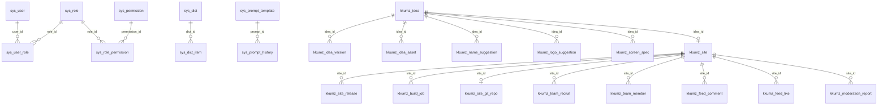

# DOC-KZ-07. Kkumz 데이터모델링 및 인터페이스 정의서 (07_Kkumz_데이터모델링_및_인터페이스정의서.md)

- **문서 번호**: DOC-KZ-07 (동일 참조본: [`04_Database_스키마설계서.md`](./04_Database_스키마설계서.md))
- **대상 데이터베이스**: PostgreSQL 18.6 (`pgvector`, 데이터베이스명: `sync_kkumz` / `kkumz`, 포트 `5432`)
- **원천 스크립트**: `services/kkumz/db/00_extensions.sql` ~ `05_sample_dev.sql` (6-File DB SSOT)
- **원천 컨트롤러**: `KkumzController.java` (`/api/v1/kkumz`), `KkumzSystemController.java` (`/api/v1/kkumz/sys`)

---

## 1. 데이터베이스 6단계 표준 파일 체계 (`services/kkumz/db/`)

Kkumz 데이터베이스는 전사 표준에 따라 `services/kkumz/db/` 디렉터리 아래 6단계 SQL 파일로 구성되며, `ON CONFLICT` 구문 없이 결정론적 고유 ID 기반의 순수 `INSERT INTO` 구문으로만 초기화됩니다.

| 실행 순서 | 파일명 | 역할 및 포함 객체 |
| :---: | :--- | :--- |
| **00** | `00_extensions.sql` | PostgreSQL 18.6 확장 모듈 활성화 (`uuid-ossp`, `pg_trgm`, `vector`) |
| **01** | `01_schema_system.sql` | 시스템 공통 RBAC, 사전, 동적 환경설정, 프롬프트 및 인앱 가이드 테이블 **12종** (`sys_user`, `sys_role`, `sys_permission`, `sys_user_role`, `sys_role_permission`, `sys_dict`, `sys_dict_item`, `sys_log`, `sys_config`, `sys_page_help`, `sys_prompt_template`, `sys_prompt_history`) |
| **02** | `02_schema_domain.sql` | Kkumz 도메인 전용 테이블 **19종** (`kkumz_idea`, `kkumz_idea_version`, `kkumz_name_suggestion`, `kkumz_logo_suggestion`, `kkumz_screen_spec`, `kkumz_site`, `kkumz_site_release`, `kkumz_build_job`, `kkumz_team_recruit`, `kkumz_team_member`, `kkumz_feed_comment`, `kkumz_feed_like`, `kkumz_moderation_report`, `kkumz_ai_prompt_template`, `kkumz_notification`, `kkumz_idea_asset`, `kkumz_api_access_key`, `kkumz_site_git_repo`, `kkumz_feature_catalog`) |
| **03** | `03_seed_system.sql` | 4대 시스템 역할, 6대 기본 사용자 계정, 공통 시스템 메뉴(`perm-kkumz-sys-*`, `/system/config`, `/system/prompt` 포함), 공통 코드 사전 22종, 동적 환경설정 `sys_config` 15종 |
| **04** | `04_seed_domain.sql` | 어드민 백오피스 도메인 메뉴(`perm-kkumz-dom-001` ~ `022`), 역할별 메뉴 권한 매핑, AI 프롬프트 템플릿 8종(`tpl-kkumz-001` ~ `008` 및 `sys_prompt_template`, `sys_prompt_history`), API 액세스키 4종, 52종 기능 카탈로그(`kkumz_feature_catalog`), 화면별 인앱 가이드(`sys_page_help`) |
| **05** | `05_sample_dev.sql` | [DEV/TEST] 대표 창업 프로젝트(`matcha-atelier`, `desk-orbit`, `seoul-run-club`, `bean-chronicle` 등)의 아이디어·버전·네이밍·로고·화면·사이트·릴리즈·빌드·팀빌딩·피드·신고·알림 시드 데이터 |

---

## 2. 도메인 엔티티 관계도 (ERD)

---

## 3. 시스템 공통 테이블 명세 (`01_schema_system.sql` — 12개 테이블)

| 번호 | 테이블명 | PK | 주요 컬럼 구성 | 용도 |
| :---: | :--- | :--- | :--- | :--- |
| 1 | `sys_user` | `id` (`VARCHAR(64)`) | `username` (UK), `password`, `realname`, `avatar`, `email`, `phone`, `org_code`, `status`, `del_flag`, `create_time` | 운영자, 모더레이터, 창업가 메이커 사용자 계정 원장 |
| 2 | `sys_role` | `id` (`VARCHAR(64)`) | `role_name`, `role_code` (UK), `description`, `create_time` | 시스템 역할 (`role_admin`, `role_moderator`, `role_creator`, `role_developer`) |
| 3 | `sys_permission` | `id` (`VARCHAR(64)`) | `parent_id`, `name`, `url`, `component`, `component_name`, `menu_type`, `perms`, `sort_no`, `icon`, `is_route`, `is_leaf` | 어드민 백오피스 DB 단일 원천 동적 메뉴 및 라우트 원장 |
| 4 | `sys_user_role` | `id` (`VARCHAR(64)`) | `user_id`, `role_id` (UK: `user_id, role_id`) | 사용자-시스템 역할 N:M 매핑 |
| 5 | `sys_role_permission` | `id` (`VARCHAR(64)`) | `role_id`, `permission_id` (UK: `role_id, permission_id`) | 시스템 역할-메뉴 권한 N:M 매핑 |
| 6 | `sys_dict` | `id` (`VARCHAR(64)`) | `dict_name`, `dict_code` (UK), `description`, `del_flag` | 공통 코드 그룹 (`kkumz_site_type`, `kkumz_deploy_mode` 등) |
| 7 | `sys_dict_item` | `id` (`VARCHAR(64)`) | `dict_id`, `item_text`, `item_value`, `description`, `sort_order`, `status` | 공통 코드 상세 항목 |
| 8 | `sys_log` | `id` (`VARCHAR(64)`) | `log_type`, `log_content`, `operate_type`, `userid`, `username`, `ip`, `method`, `request_url`, `cost_time`, `create_time` | 시스템 감사 및 작업 이력 로그 |
| 9 | `sys_config` | `id` (`VARCHAR(32)`) | `config_category`, `config_key` (UK), `config_name`, `config_value`, `default_value`, `value_type`, `is_secret`, `is_dynamic`, `status` | `SystemConfigHolder` 및 `ClusterEventBroadcaster` 연동 무중단 동적 환경설정 (`/system/config`) |
| 10 | `sys_page_help` | `id` (`VARCHAR(64)`) | `app_code`, `page_key` (UK), `route_name`, `title`, `category`, `summary`, `overview`, `features_json`, `lineage_json`, `steps_json`, `related_screens_json`, `tips_json`, `warnings_json`, `faq_json` | 화면별 인앱 사용자 가이드 및 데이터 리니지 마스터 (`/system/help-guide`) |
| 11 | `sys_prompt_template` | `id` (`VARCHAR(64)`) | `app_code`, `prompt_code` (UK), `prompt_name`, `category`, `caller_class`, `system_prompt`, `user_prompt_template`, `variables_schema` (`JSONB`), `output_schema`, `model_override`, `temperature`, `version`, `status` | `SystemPromptHolder` 연동 전사 AI 프롬프트 템플릿 원장 (`/system/prompt`) |
| 12 | `sys_prompt_history` | `id` (`VARCHAR(64)`) | `prompt_id`, `app_code`, `prompt_code`, `version`, `system_prompt`, `user_prompt_template`, `variables_schema`, `output_schema`, `change_reason`, `created_by`, `created_at` | AI 프롬프트 변경 이력 및 버전 롤백 원장 (`/system/prompt`) |

---

## 4. Kkumz 도메인 테이블 상세 명세 (`02_schema_domain.sql` — 19개 테이블)

| 번호 | 테이블명 | PK | 주요 컬럼 구성 | 용도 |
| :---: | :--- | :--- | :--- | :--- |
| 1 | `kkumz_idea` | `id` | `author_username`, `title`, `prompt_text`, `site_type`, `category`, `tags_json`, `visibility`, `current_step`, `selected_brand_name`, `selected_site_slug`, `selected_logo_svg`, `design_tokens_json`, `spec_markdown`, `screens_json`, `enabled_features_json`, `ai_intent_analysis_json`, `status` | 창업 아이디어·세계관 및 11-Step 스튜디오 프로젝트 마스터 |
| 2 | `kkumz_idea_version` | `id` | `idea_id`, `version_no` (UK), `title`, `prompt_text`, `spec_markdown`, `screens_json` | 기능명세서 및 화면 설계 버전 히스토리 |
| 3 | `kkumz_name_suggestion` | `id` | `idea_id`, `brand_name`, `site_slug`, `pronunciation`, `brand_story`, `score`, `slug_available`, `is_selected` | AI 브랜드 네이밍 8종 후보 |
| 4 | `kkumz_logo_suggestion` | `id` | `idea_id`, `style_name`, `svg_code`, `color_palette_json`, `typography_json`, `tags_json`, `is_selected` | AI 벡터 SVG 로고 6종 및 컬러 팔레트 후보 |
| 5 | `kkumz_screen_spec` | `id` | `idea_id`, `screen_key`, `screen_title`, `route_path`, `layout_type`, `components_json`, `sort_no` | 화면 설계 블루프린트 목록 |
| 6 | `kkumz_site` | `id` | `idea_id`, `site_slug` (UK), `site_name`, `site_type`, `category`, `brand_slogan`, `logo_svg`, `shop_site_id`, `cms_site_id`, `deploy_mode`, `active_version`, `published_version`, `deployed_url`, `custom_domain`, `is_featured`, `visibility`, `like_count`, `comment_count`, `view_count`, `status` | 배포된 멀티사이트 마스터 및 외부 엔진 매핑 |
| 7 | `kkumz_site_release` | `id` | `site_id`, `version_no` (UK), `release_note`, `deploy_mode`, `design_tokens_json`, `layout_schema_json`, `webide_files_json`, `minio_bundle_path`, `build_status`, `build_log` | 멀티사이트 버전별 릴리즈 스냅샷 및 WebIDE 파일 원장 |
| 8 | `kkumz_build_job` | `id` | `site_id`, `release_id`, `job_type`, `deploy_mode`, `status`, `duration_ms`, `error_summary`, `ai_patch_applied`, `build_log` | WebIDE 샌드박스 빌드 파이프라인 잡 및 AI 패치 이력 |
| 9 | `kkumz_team_recruit` | `id` | `site_id`, `position_role`, `title`, `description`, `required_skills_json`, `headcount`, `recruited_count`, `status` | 창업 팀원 모집 공고 |
| 10 | `kkumz_team_member` | `id` | `site_id`, `recruit_id`, `username`, `display_name`, `member_role`, `position_role`, `join_type`, `application_message`, `status` | 프로젝트 합류 팀원 및 지원 내역 |
| 11 | `kkumz_feed_comment` | `id` | `site_id`, `username`, `display_name`, `author_role_badge`, `content`, `created_at` | 쇼케이스 피드 응원·피드백 댓글 |
| 12 | `kkumz_feed_like` | `id` | `site_id`, `username` (UK), `created_at` | 쇼케이스 피드 좋아요 중복 방지 원장 |
| 13 | `kkumz_moderation_report` | `id` | `target_type`, `target_id`, `site_id`, `reporter_username`, `reason_category`, `reason_detail`, `status`, `action_taken`, `moderator_username`, `resolved_at` | 신고 접수 및 모더레이션 심사 처분 원장 |
| 14 | `kkumz_ai_prompt_template` | `id` | `template_code` (UK), `template_name`, `stage_type`, `model_name`, `temperature`, `system_prompt`, `user_prompt_template`, `forbidden_words_json`, `status` | 단계별 AI 프롬프트 템플릿 및 금지어 필터 |
| 15 | `kkumz_notification` | `id` | `recipient_username`, `notif_type`, `title`, `message`, `link_url`, `is_read`, `created_at` | 실시간 인앱 알림 센터 원장 |
| 16 | `kkumz_idea_asset` | `id` | `idea_id`, `asset_type`, `original_name`, `stored_name`, `file_url`, `mime_type`, `file_size`, `caption`, `extracted_text` | 아이디어·사이트 업로드 미디어 및 참고 문서 자산 |
| 17 | `kkumz_api_access_key` | `id` | `direction`, `service_code`, `key_name`, `base_url`, `access_key` (UK), `secret_key`, `scopes_json`, `rate_limit_rpm`, `call_count`, `status` | 서비스 간 API 연동 액세스키 및 클라이언트 인증키 관리 |
| 18 | `kkumz_site_git_repo` | `id` | `site_id` (UK), `provider`, `repo_owner`, `repo_name`, `repo_html_url`, `clone_ssh_url`, `ssh_key_fingerprint`, `site_access_key`, `last_commit_sha`, `commit_history_json` | 멀티사이트 Git 리포지토리 프로비저닝 및 배포 키 원장 |
| 19 | `kkumz_feature_catalog` | `id` | `feature_code` (UK), `engine_code`, `category_code`, `category_name`, `title`, `subtitle`, `description`, `sdui_archetype`, `default_config_json` | SyncShop x SyncCMS x AI 52종 전체 기능 카탈로그 마스터 |

---

## 5. REST API 인터페이스 전체 명세 (`/api/v1/kkumz/**`)

| 구분 | HTTP Method & URI | 설명 |
| :--- | :--- | :--- |
| **대시보드** | `GET /api/v1/kkumz/stats` | 운영 종합 KPI 집계 조회 |
| **아이디어·자산** | `GET, POST, PUT, DELETE /api/v1/kkumz/ideas/{id?}` | 아이디어·세계관 CRUD 및 52종 기능 카탈로그·자산 연동 |
| **브랜드·로고·명세** | `POST /api/v1/kkumz/ideas/{id}/generate-names`, `select-name`, `generate-logos`, `select-logo`, `generate-spec`, `versions`, `rollback`, `generate-screens` | 11-Step 모듈형 AI 스튜디오 단계별 추론 및 버전 롤백 |
| **배포·WebIDE** | `POST /api/v1/kkumz/sites/{siteSlug}/deploy`, `unpublish`, `webide-save`, `webide-ai-fix` | 2-Track 라이브 배포, 비공개 전환, WebIDE 샌드박스 빌드 및 AI 자동 패치 |
| **라이브 런타임** | `GET /api/v1/kkumz/sites/{siteSlug}/runtime`, `POST /orders`, `POST /forms`, `POST /concierge` | 라이브 멀티사이트 렌더링, SyncShop 주문, SyncCMS 폼 접수, AI 컨시어지 |
| **커뮤니티·모더** | `GET /api/v1/kkumz/feed`, `POST /like`, `GET, POST /comments`, `GET, POST /recruits`, `POST /apply`, `GET /team-members`, `POST /approve`, `GET, POST /moderation/reports`, `POST /resolve` | 쇼케이스 피드, 팀빌딩 라운지, 신고 심사 및 사이트 정지 |
| **동적 설정·프롬프트** | `GET, POST /api/v1/kkumz/sys/config/**`, `GET, POST /api/v1/kkumz/sys/prompt/**`, `GET /api/v1/kkumz/sys/help/**`, `GET /api/v1/kkumz/sys/permission/getUserPermissionByToken` | `SystemConfigHolder`(`sys_config`), `SystemPromptHolder`(`sys_prompt_template`, `sys_prompt_history`), `sys_page_help` 및 동적 메뉴 인가 |
