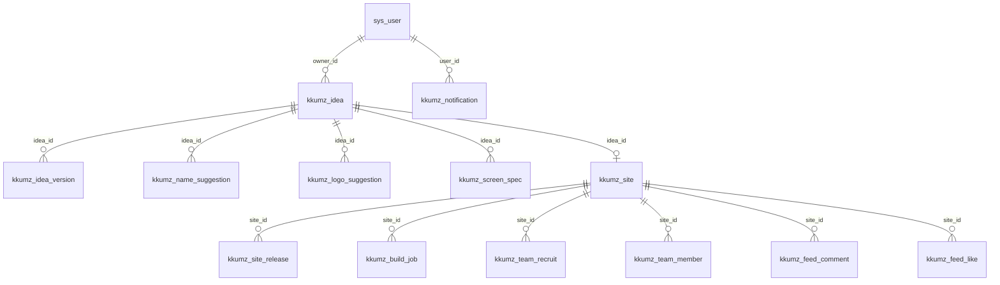

# DOC-KZ-07. Kkumz 데이터모델링 및 인터페이스 정의서

- **문서 번호**: DOC-KZ-07
- **대상 데이터베이스**: PostgreSQL 18.6 (`kkumz` 데이터베이스, 포트 `5432`)
- **원천 스크립트**: `services/kkumz/db/00_extensions.sql` ~ `05_sample_dev.sql`
- **원천 컨트롤러**: `KkumzController.java` (`/api/v1/kkumz`), `KkumzSystemController.java` (`/api/v1/kkumz/sys`)

---

## 1. 데이터베이스 6단계 표준 파일 체계 (`services/kkumz/db/`)

Kkumz 데이터베이스는 전사 표준에 따라 `services/kkumz/db/` 디렉터리 아래 6단계 SQL 파일로 구성되며, `ON CONFLICT` 구문 없이 결정론적 고유 ID 기반의 순수 `INSERT INTO` 구문으로만 초기화됩니다.

| 실행 순서 | 파일명 | 역할 및 포함 객체 |
| :---: | :--- | :--- |
| **00** | `00_extensions.sql` | PostgreSQL 18.6 확장 모듈 활성화 (`uuid-ossp`, `pg_trgm`, `vector`) |
| **01** | `01_schema_system.sql` | 시스템 공통 RBAC 및 사전 테이블 **8종** (`sys_user`, `sys_role`, `sys_permission`, `sys_user_role`, `sys_role_permission`, `sys_dict`, `sys_dict_item`, `sys_log`) |
| **02** | `02_schema_domain.sql` | Kkumz 도메인 전용 테이블 **15종** (`kkumz_idea` ~ `kkumz_notification`) 및 인덱스 |
| **03** | `03_seed_system.sql` | 4대 시스템 역할, 6대 기본 사용자 계정, 공통 시스템 메뉴(`perm-kkumz-sys-*`), 공통 코드 사전 4종 |
| **04** | `04_seed_domain.sql` | 어드민 백오피스 도메인 메뉴(`perm-kkumz-dom-001` ~ `022`), 역할별 메뉴 권한 매핑, AI 프롬프트 템플릿 4종(`tpl-kkumz-001` ~ `004`) |
| **05** | `05_sample_dev.sql` | [DEV/TEST] 4대 대표 창업 프로젝트(`matcha-atelier`, `desk-orbit`, `seoul-run-club`, `bean-chronicle`)의 아이디어·버전·네이밍·로고·화면·사이트·릴리즈·빌드·팀빌딩·피드·신고·알림 시드 데이터 |

---

## 2. 도메인 엔티티 관계도 (ERD)

---

## 3. 시스템 공통 테이블 명세 (`01_schema_system.sql` — 8개 테이블)

| 번호 | 테이블명 | PK | 주요 컬럼 구성 | 용도 |
| :---: | :--- | :--- | :--- | :--- |
| 1 | `sys_user` | `id` (`VARCHAR(64)`) | `username` (UK), `password`, `realname`, `avatar`, `email`, `phone`, `org_code`, `status`, `del_flag`, `create_time` | 운영자, 모더레이터, 창업가 메이커 사용자 계정 원장 |
| 2 | `sys_role` | `id` (`VARCHAR(64)`) | `role_name`, `role_code` (UK), `description`, `create_time` | 시스템 역할 (`role_admin`, `role_moderator`, `role_creator`, `role_developer`) |
| 3 | `sys_permission` | `id` (`VARCHAR(64)`) | `parent_id`, `name`, `url`, `component`, `component_name`, `menu_type` (0:폴더, 1:메뉴, 2:버튼), `perms`, `sort_no`, `icon`, `is_route`, `is_leaf`, `keep_alive`, `hidden`, `status`, `del_flag` | 어드민 백오피스 DB 단일 원천 동적 메뉴 및 라우트 원장 |
| 4 | `sys_user_role` | `id` (`VARCHAR(64)`) | `user_id`, `role_id` (UK: `user_id, role_id`) | 사용자-시스템 역할 N:M 매핑 |
| 5 | `sys_role_permission` | `id` (`VARCHAR(64)`) | `role_id`, `permission_id` (UK: `role_id, permission_id`) | 시스템 역할-메뉴 권한 N:M 매핑 |
| 6 | `sys_dict` | `id` (`VARCHAR(64)`) | `dict_name`, `dict_code` (UK), `description`, `del_flag` | 공통 코드 그룹 (`kkumz_site_type`, `kkumz_deploy_mode` 등) |
| 7 | `sys_dict_item` | `id` (`VARCHAR(64)`) | `dict_id`, `item_text`, `item_value`, `description`, `sort_order`, `status` | 공통 코드 상세 항목 |
| 8 | `sys_log` | `id` (`VARCHAR(64)`) | `log_type`, `log_content`, `operate_type`, `userid`, `username`, `ip`, `method`, `request_url`, `cost_time`, `create_time` | 시스템 감사 및 작업 이력 로그 |

---

## 4. Kkumz 도메인 테이블 상세 명세 (`02_schema_domain.sql` — 15개 테이블)

### 4.1 `kkumz_idea` (창업 아이디어 및 6단계 스튜디오 프로젝트 마스터)
| 컬럼명 | 데이터 타입 | 제약조건 | 설명 |
| :--- | :--- | :--- | :--- |
| `id` | `VARCHAR(64)` | `PRIMARY KEY` | 아이디어 고유 ID (예: `idea-kkumz-001`) |
| `owner_id` | `VARCHAR(64)` | `NOT NULL` | 생성자 사용자 ID (`sys_user.id`) |
| `owner_name` | `VARCHAR(100)` | `NOT NULL` | 생성자 표시명 (예: `한소연 대표`) |
| `title` | `VARCHAR(200)` | `NOT NULL` | 초기 아이디어 제목 |
| `summary` | `TEXT` | `NOT NULL` | 아이디어 한 줄 핵심 요약 |
| `problem_statement` | `TEXT` | `NULL` | 해결하고자 하는 고객 페인포인트 |
| `target_audience` | `VARCHAR(500)` | `NULL` | 핵심 타깃 고객군 정의 |
| `site_type` | `VARCHAR(32)` | `NOT NULL DEFAULT 'COMMERCE'` | 사이트 유형 (`COMMERCE`, `CMS_SITE`, `HYBRID`) |
| `current_step` | `INT` | `NOT NULL DEFAULT 1` | 스튜디오 진행 단계 (`1` ~ `6`) |
| `selected_brand_name` | `VARCHAR(120)` | `NULL` | Step 2에서 확정된 브랜드명 |
| `selected_site_slug` | `VARCHAR(100)` | `NULL` | 확정된 멀티사이트 슬러그 (예: `matcha-atelier`) |
| `selected_logo_svg` | `TEXT` | `NULL` | Step 3에서 확정된 인라인 벡터 `<svg>` 코드 |
| `design_tokens_json` | `JSONB` | `NOT NULL DEFAULT '{}'` | 5대 브랜드 디자인 토큰 (`primary`, `secondary`, `accent`, `surface`, `radius`) |
| `spec_markdown` | `TEXT` | `NULL` | Step 4에서 생성/편집된 마크다운 기능명세서 전문 |
| `screens_json` | `JSONB` | `NOT NULL DEFAULT '[]'` | Step 5 화면 설계 블루프린트 요약 배열 |
| `status` | `VARCHAR(32)` | `NOT NULL DEFAULT 'DRAFT'` | 상태 (`DRAFT`, `SPEC_READY`, `DEPLOYED`, `ARCHIVED`) |
| `created_at` / `updated_at` | `TIMESTAMPTZ` | `NOT NULL DEFAULT NOW()` | 생성 및 최종 수정 시각 |

### 4.2 `kkumz_idea_version` (기능명세서 및 화면 설계 버전 히스토리)
- **PK**: `id` (`VARCHAR(64)`), **UK**: `(idea_id, version_no)`
- **주요 컬럼**: `idea_id`, `version_no` (`INT`), `change_summary` (`VARCHAR(300)`), `spec_markdown` (`TEXT`), `screens_json` (`JSONB`), `design_tokens_json` (`JSONB`), `created_by`, `created_at`

### 4.3 `kkumz_name_suggestion` (Step 2 AI 브랜드 네이밍 8종 후보)
- **PK**: `id` (`VARCHAR(64)`)
- **주요 컬럼**: `idea_id`, `brand_name` (`VARCHAR(120)`), `language_type` (`KR`, `EN`, `MIXED`), `tagline` (`VARCHAR(300)`), `rationale` (`TEXT`), `recommended_slug` (`VARCHAR(100)`), `slug_available` (`BOOLEAN`), `is_selected` (`BOOLEAN`), `sort_no` (`INT`), `created_at`

### 4.4 `kkumz_logo_suggestion` (Step 3 AI 벡터 SVG 로고 6종 후보)
- **PK**: `id` (`VARCHAR(64)`)
- **주요 컬럼**: `idea_id`, `style_name` (`VARCHAR(100)`), `concept_note` (`VARCHAR(300)`), `svg_code` (`TEXT`), `color_palette_json` (`JSONB`), `is_selected` (`BOOLEAN`), `sort_no` (`INT`), `created_at`

### 4.5 `kkumz_screen_spec` (Step 5 화면 설계 블루프린트)
- **PK**: `id` (`VARCHAR(64)`)
- **주요 컬럼**: `idea_id`, `screen_code` (`VARCHAR(64)`), `screen_name` (`VARCHAR(150)`), `route_path` (`VARCHAR(150)`), `layout_type` (`HERO_GRID`, `PRODUCT_DETAIL`, `ARTICLE_VIEW`, `CHECKOUT_FLOW` 등), `sections_json` (`JSONB`), `data_binding_note` (`TEXT`), `sort_no` (`INT`), `created_at`

### 4.6 `kkumz_site` (배포된 멀티사이트 마스터 및 외부 엔진 매핑)
| 컬럼명 | 데이터 타입 | 제약조건 | 설명 |
| :--- | :--- | :--- | :--- |
| `id` | `VARCHAR(64)` | `PRIMARY KEY` | 사이트 고유 ID (예: `site-kkumz-001`) |
| `idea_id` | `VARCHAR(64)` | ` NOT NULL` | 원본 아이디어 ID (`kkumz_idea.id`) |
| `site_slug` | `VARCHAR(100)` | `NOT NULL UNIQUE` | 고유 라우팅 슬러그 (예: `matcha-atelier`) |
| `brand_name` | `VARCHAR(120)` | `NOT NULL` | 브랜드 표시명 |
| `site_type` | `VARCHAR(32)` | `NOT NULL` | `COMMERCE`, `CMS_SITE`, `HYBRID` |
| `deploy_mode` | `VARCHAR(32)` | `NOT NULL DEFAULT 'DYNAMIC_SDUI'` | `DYNAMIC_SDUI` (노코드 즉시배포) / `CUSTOM_BUNDLE` (WebIDE 커스텀 번들) |
| `shop_site_id` | `VARCHAR(64)` | `NULL` | `sync_shop.pms_product` / `oms_order` 멀티테넌트 키 |
| `cms_site_id` | `BIGINT` | `NULL` | `sync_cms.cms_site` / `cms_content` 멀티테넌트 키 |
| `active_version` | `INT` | `NOT NULL DEFAULT 1` | 스튜디오에서 편집 중인 최신 작업 릴리즈 버전 번호 |
| `published_version` | `INT` | `DEFAULT NULL` | 외부에 공개 배포(`deploySite`)된 라이브 릴리즈 버전 번호 (미배포 초안 시 `NULL`) |
| `published_at` | `TIMESTAMPTZ` | `DEFAULT NULL` | 최근 라이브 공개 배포 시각 |
| `visibility` | `VARCHAR(32)` | `NOT NULL DEFAULT 'PRIVATE'` | 공개 범위 (`PRIVATE`: 소유자 전용 초안, `PUBLIC`: 쇼케이스 전체 공개, `UNLISTED`: 링크 공개) |
| `deployed_url` | `VARCHAR(255)` | `NOT NULL` | 플랫폼 내부 라이브 경로 (`/s/{site_slug}`) |
| `custom_domain` | `VARCHAR(255)` | `NULL` | 와일드카드 서브도메인 (`{site_slug}.kkumz.io`) 또는 외부 도메인 |
| `status` | `VARCHAR(32)` | `NOT NULL DEFAULT 'DRAFT'` | `DRAFT` (초안/미배포), `ACTIVE` (라이브 배포 완료), `SUSPENDED` (모더레이션 정지) |
| `visits_count` / `likes_count` | `INT` | `NOT NULL DEFAULT 0` | 누적 방문수 및 쇼케이스 피드 좋아요 수 |
| `owner_id` / `owner_name` | `VARCHAR` | `NOT NULL` | 소유 창업가 ID 및 이름 |
| `created_at` / `updated_at` | `TIMESTAMPTZ` | `NOT NULL DEFAULT NOW()` | 최초 배포 및 수정 시각 |

### 4.7 `kkumz_site_release` (멀티사이트 버전별 릴리즈 스냅샷 및 WebIDE 파일 원장)
- **PK**: `id` (`VARCHAR(64)`), **UK**: `(site_id, version_no)`
- **주요 컬럼**: `site_id`, `version_no` (`INT`), `deploy_mode`, `release_note` (`VARCHAR(500)`), `design_tokens_json` (`JSONB`), `layout_schema_json` (`JSONB`), `webide_files_json` (`JSONB` — `HeroSection.vue`, `CustomStyles.css`, `site.config.json` 소스코드 배열), `minio_bundle_path` (`VARCHAR(500)`), `build_status` (`SUCCESS`, `FAILED`, `BUILDING`), `build_log` (`TEXT`), `created_by`, `created_at`

### 4.8 `kkumz_build_job` (WebIDE 샌드박스 빌드 파이프라인 잡 및 AI 패치 이력)
- **PK**: `id` (`VARCHAR(64)`)
- **주요 컬럼**: `site_id`, `release_id`, `version_no`, `trigger_type` (`INITIAL_DEPLOY`, `WEBIDE_SAVE`, `AI_AUTO_FIX`), `status` (`SUCCESS`, `FAILED`, `BUILDING`), `duration_ms` (`INT`), `error_summary` (`VARCHAR(500)`), `ai_fix_suggestion` (`TEXT`), `build_log` (`TEXT`), `created_at`

### 4.9 `kkumz_team_recruit` (창업 팀원 모집 공고)
- **PK**: `id` (`VARCHAR(64)`)
- **주요 컬럼**: `idea_id`, `site_id`, `title` (`VARCHAR(200)`), `role_needed` (`FRONTEND`, `DESIGNER`, `MARKETER`, `MD`, `PLANNER`, `CO_FOUNDER`), `description` (`TEXT`), `reward_type` (`VARCHAR(100)`), `status` (`OPEN`, `CLOSED`), `applicants_count` (`INT`), `created_by`, `created_at`

### 4.10 `kkumz_team_member` (프로젝트 팀원 및 지원 내역)
- **PK**: `id` (`VARCHAR(64)`)
- **주요 컬럼**: `idea_id`, `site_id`, `recruit_id`, `user_id`, `user_name`, `role_code` (`OWNER`, `EDITOR`, `DEVELOPER`, `MD`), `status` (`ACTIVE`, `PENDING`, `REJECTED`), `motivation` (`TEXT`), `joined_at`

### 4.11 ~ 4.15 커뮤니티·모더레이션·AI 프롬프트·알림 테이블
| 테이블명 | PK | 주요 컬럼 구성 | 용도 |
| :--- | :--- | :--- | :--- |
| `kkumz_feed_comment` | `id` | `site_id`, `author_id`, `author_name`, `content`, `created_at` | 쇼케이스 피드 응원·피드백 댓글 |
| `kkumz_feed_like` | `id` | `site_id`, `user_id`, `created_at` (UK: `site_id, user_id`) | 쇼케이스 피드 좋아요 중복 방지 원장 |
| `kkumz_moderation_report` | `id` | `target_type` (`SITE`, `COMMENT`, `RECRUIT`), `target_id`, `reason_code`, `description`, `reporter_name`, `status` (`PENDING`, `RESOLVED`, `DISMISSED`), `action_taken`, `resolved_by`, `created_at`, `resolved_at` | 신고 접수 및 모더레이션 심사 처분 원장 |
| `kkumz_ai_prompt_template` | `id` | `step_code` (UK), `template_name`, `model_name`, `temperature`, `system_prompt`, `user_prompt_template`, `forbidden_words_json`, `status`, `updated_at` | 단계별 AI 프롬프트 템플릿 및 금지어 필터 |
| `kkumz_notification` | `id` | `user_id`, `noti_type` (`TEAM_APPLY`, `BUILD_DONE`, `COMMERCE_ORDER`, `FORM_SUBMIT`), `title`, `message`, `link_url`, `is_read`, `created_at` | 실시간 인앱 알림 센터 원장 |

---

## 5. REST API 인터페이스 전체 명세 (`/api/v1/kkumz/**`)

### 5.1 도메인 비즈니스 API (`KkumzController` — Base Path: `/api/v1/kkumz`)

| 구분 | HTTP Method & URI | 설명 | 요청 Body / 파라미터 |
| :--- | :--- | :--- | :--- |
| **대시보드** | `GET /api/v1/kkumz/stats` | 운영 종합 KPI 집계 조회 | - |
| **아이디어** | `GET /api/v1/kkumz/ideas` | 창업 아이디어 전체 목록 조회 | - |
| **아이디어** | `GET /api/v1/kkumz/ideas/{id}` | 아이디어 단건 상세(네이밍·로고·화면·버전·사이트 포함) 조회 | `@PathVariable id` |
| **아이디어** | `POST /api/v1/kkumz/ideas` | 신규 아이디어(Step 1) 생성 및 초기 버전 스냅샷 생성 | `IdeaCreateRequest` (`title`, `summary`, `problemStatement`, `targetAudience`, `siteType`) |
| **아이디어** | `PUT /api/v1/kkumz/ideas/{id}` | 아이디어 기본 정보·기능명세서 수정 및 새 버전 스냅샷 기록 | `IdeaUpdateRequest` |
| **아이디어** | `DELETE /api/v1/kkumz/ideas/{id}` | 아이디어 및 연관 후보 데이터 삭제 | `@PathVariable id` |
| **Step 2 네이밍** | `POST /api/v1/kkumz/ideas/{id}/generate-names` | AI 브랜드 네이밍 8종 후보 생성 및 슬러그 중복 검증 | `@PathVariable id` |
| **Step 2 네이밍** | `POST /api/v1/kkumz/ideas/{id}/select-name` | 브랜드명 및 사이트 슬러그 확정 | `SelectNameRequest` (`suggestionId`, `customSlug`) |
| **Step 3 로고** | `POST /api/v1/kkumz/ideas/{id}/generate-logos` | AI 벡터 SVG 로고 6종 및 디자인 토큰 생성 | `@PathVariable id` |
| **Step 3 로고** | `POST /api/v1/kkumz/ideas/{id}/select-logo` | 벡터 SVG 로고 및 컬러 토큰 확정 | `SelectLogoRequest` (`suggestionId`) |
| **Step 4 명세서** | `POST /api/v1/kkumz/ideas/{id}/generate-spec` | AI 마크다운 기능명세서 생성 및 버전 스냅샷 저장 | `@PathVariable id` |
| **Step 4 버전** | `GET /api/v1/kkumz/ideas/{id}/versions` | 기능명세서 버전 히스토리 목록 조회 | `@PathVariable id` |
| **Step 4 롤백** | `POST /api/v1/kkumz/ideas/{id}/rollback` | 특정 버전(`versionNo`)으로 기능명세서·화면·토큰 롤백 | `RollbackRequest` (`versionNo`) |
| **Step 5 화면** | `POST /api/v1/kkumz/ideas/{id}/generate-screens` | 사이트 유형별 화면 블루프린트 자동 설계 | `@PathVariable id` |
| **Step 6 배포** | `POST /api/v1/kkumz/sites/{siteSlug}/deploy` | 2-Track(`DYNAMIC_SDUI` / `CUSTOM_BUNDLE`) 멀티사이트 라이브 공개 배포 (`published_version = active_version`) | `DeploySiteRequest` (`deployMode`, `releaseNote`, `visibility`, `customDomain`) |
| **Step 6 비공개 전환** | `POST /api/v1/kkumz/sites/{siteSlug}/unpublish` | 배포된 사이트를 비공개 초안(`DRAFT` / `PRIVATE` / `published_version = NULL`)으로 즉시 전환 | `@PathVariable siteSlug` |
| **멀티사이트** | `GET /api/v1/kkumz/sites` | 배포된 멀티사이트 전체 목록 조회 | - |
| **멀티사이트** | `PUT /api/v1/kkumz/sites/{id}/status` | 멀티사이트 운영 상태 변경 (`ACTIVE` / `DRAFT` / `SUSPENDED`) | `{ "status": "SUSPENDED" }` |
| **라이브 런타임** | `GET /api/v1/kkumz/sites/{siteSlug}/runtime` | 멀티사이트 런타임 조회 (소유자/팀원은 `active_version` 프리뷰, 타 사용자/방문자는 배포 완료 시에만 `published_version` 반환, 미배포 시 `403` 차단) | `@PathVariable siteSlug` |
| **실주문 연동** | `POST /api/v1/kkumz/sites/{siteSlug}/orders` | 라이브 사이트에서 `sync_shop.oms_order` 실제 주문 생성 | `LiveSiteOrderRequest` (`productId`, `quantity`, `receiverName`, `receiverPhone`, `receiverAddress`) |
| **리드 폼 연동** | `POST /api/v1/kkumz/sites/{siteSlug}/forms` | 라이브 사이트에서 `sync_cms.cms_form_data` 폼 데이터 접수 | `LiveSiteFormSubmitRequest` (`formCode`, `applicantName`, `contact`, `message`) |
| **AI 컨시어지** | `POST /api/v1/kkumz/sites/{siteSlug}/concierge` | 라이브 사이트 방문자 질문에 대한 AI 브랜드 컨시어지 응답 | `SiteConciergeRequest` (`question`) |
| **WebIDE 빌드** | `POST /api/v1/kkumz/sites/{siteSlug}/webide-save` | WebIDE 가상 SFC 파일 저장 및 샌드박스 빌드 실행 | `WebIdeSaveRequest` (`releaseNote`, `webideFilesJson`) |
| **AI 빌드 패치** | `POST /api/v1/kkumz/sites/{siteSlug}/webide-ai-fix` | 빌드 실패(`FAILED`) 코드 AI 자동 패치 및 재빌드·배포 | `@PathVariable siteSlug` |
| **빌드 잡** | `GET /api/v1/kkumz/builds` | 샌드박스 빌드 파이프라인 전체 이력 조회 | - |
| **쇼케이스 피드** | `GET /api/v1/kkumz/feed` | 커뮤니티 쇼케이스 피드 목록 조회 | - |
| **피드 좋아요** | `POST /api/v1/kkumz/feed/{siteId}/like` | 쇼케이스 사이트 좋아요 토글 | `FeedLikeRequest` (`userId`) |
| **피드 댓글** | `GET, POST /api/v1/kkumz/feed/{siteId}/comments` | 쇼케이스 피드 댓글 목록 조회 및 신규 작성 | `CommentCreateRequest` (`authorId`, `authorName`, `content`) |
| **팀빌딩 공고** | `GET, POST /api/v1/kkumz/recruits` | 팀원 모집 공고 조회 및 신규 공고 등록 | `RecruitCreateRequest` |
| **팀빌딩 상태** | `PUT /api/v1/kkumz/recruits/{id}/status` | 팀원 모집 공고 상태 변경 (`OPEN` / `CLOSED`) | `{ "status": "CLOSED" }` |
| **팀빌딩 지원** | `POST /api/v1/kkumz/recruits/{id}/apply` | 모집 포지션 합류 지원 (`PENDING` 생성) | `TeamApplyRequest` (`userId`, `userName`, `motivation`) |
| **팀원 관리** | `GET /api/v1/kkumz/team-members` | 프로젝트 팀원 및 지원자 목록 조회 (`?siteId=` 필터 지원) | `@RequestParam siteId` |
| **팀원 승인** | `POST /api/v1/kkumz/team-members/{id}/approve` | 팀원 합류 승인(`ACTIVE`) 또는 반려(`REJECTED`) | `TeamApproveRequest` (`status`) |
| **모더레이션** | `GET, POST /api/v1/kkumz/moderation/reports` | 신고 목록 조회 및 신규 신고 접수 | `ModerationReportRequest` |
| **모더레이션** | `POST /api/v1/kkumz/moderation/reports/{id}/resolve` | 신고 심사 처분 및 대상 사이트 즉시 정지(`suspendSite`) | `ModerationResolveRequest` (`status`, `actionTaken`, `resolvedBy`, `suspendSite`) |
| **AI 프롬프트** | `GET, POST /api/v1/kkumz/prompts` | 단계별 AI 프롬프트 템플릿 및 금지어 조회·수정 | `PromptUpdateRequest` |
| **알림 센터** | `GET /api/v1/kkumz/notifications` | 사용자별 인앱 알림 목록 조회 (`?userId=`) | `@RequestParam userId` |
| **알림 읽음** | `POST /api/v1/kkumz/notifications/{id}/read` | 알림 단건(또는 `id = read-all` 전체) 읽음 처리 | `@PathVariable id` |

### 5.2 시스템 및 동적 인가 API (`KkumzSystemController` — Base Path: `/api/v1/kkumz/sys`)

| HTTP Method & URI | 설명 |
| :--- | :--- |
| `POST /api/v1/kkumz/sys/login` | 어드민/포털 로그인 인증 및 토큰 발급 |
| `POST /api/v1/kkumz/sys/logout` | 세션 로그아웃 |
| `GET /api/v1/kkumz/sys/user/getUserInfo` | 현재 로그인 사용자 프로필 및 역할 코드 조회 |
| `GET /api/v1/kkumz/sys/permission/getUserPermissionByToken` | **전사 표준 동적 라우팅 메뉴 트리(`menu`) 및 권한 코드(`auth`) 반환** |
| `GET /api/v1/kkumz/sys/permission/list` | 전체 메뉴 권한 트리 조회 (`SCR-KZ-SYS-03`) |
| `POST, PUT /api/v1/kkumz/sys/permission/save` | 메뉴 권한 등록 및 수정 |
| `DELETE /api/v1/kkumz/sys/permission/delete` | 메뉴 권한 삭제 |
| `GET /api/v1/kkumz/sys/user/list` | 시스템 사용자 페이징 목록 조회 (`SCR-KZ-SYS-01`) |
| `POST, PUT /api/v1/kkumz/sys/user/save` | 시스템 사용자 등록 및 수정 |
| `DELETE /api/v1/kkumz/sys/user/delete` | 시스템 사용자 삭제 |
| `GET /api/v1/kkumz/sys/role/list` | 시스템 역할 목록 조회 (`SCR-KZ-SYS-02`) |
| `POST, PUT /api/v1/kkumz/sys/role/save` | 시스템 역할 등록 및 수정 |
| `GET /api/v1/kkumz/sys/permission/queryRolePermission` | 특정 역할에 매핑된 권한 ID 배열 조회 |
| `POST /api/v1/kkumz/sys/permission/saveRolePermission` | 역할별 메뉴 권한 매핑 일괄 저장 |
| `GET /api/v1/kkumz/sys/dict/list` & `/sys/dictItem/list` | 공통 사전 그룹 및 상세 코드 항목 조회 (`SCR-KZ-SYS-04`) |
