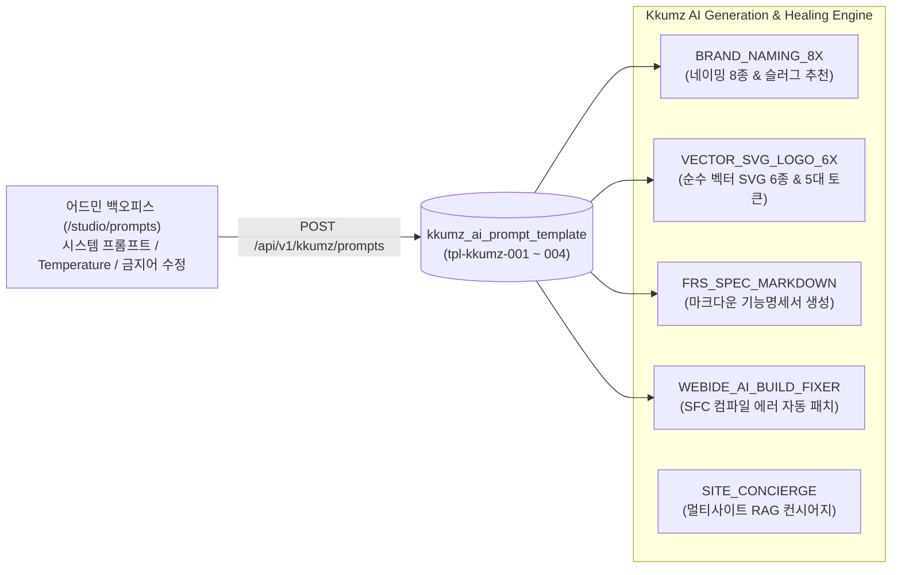

# DOC-KZ-08. Kkumz 기술 연동 및 AI 프롬프트 명세서

- **문서 번호**: DOC-KZ-08
- **대상 서비스**: `services/kkumz` (`Server/kkumz-server-admin`)
- **데이터베이스 원천**: `db/04_seed_domain.sql` (`kkumz_ai_prompt_template`)

---

## 1. AI 오케스트레이션 아키텍처 개요

Kkumz 백엔드는 SyncSeries 전사 AI 프레임워크 표준인 **AgentScope Java (`io.agentscope:agentscope-harness`)** 와 데이터베이스 기반 동적 프롬프트 관리 원장(`kkumz_ai_prompt_template`)을 결합하여 6-Step 스튜디오 생성 파이프라인 및 멀티사이트 라이브 컨시어지를 구동합니다.



---

## 2. 4대 표준 AI 프롬프트 템플릿 명세 (`db/04_seed_domain.sql`)

어드민 백오피스 **AI 프롬프트 & 필터 관리 (`SCR-KZ-03`, `/studio/prompts`)** 에서 실시간 조회·튜닝 가능한 4대 핵심 프롬프트 템플릿입니다.

| 템플릿 ID | 단계 코드 (`step_code`) | 템플릿명 (`template_name`) | 기본 모델 (`model_name`) | Temperature | 금지어 필터 (`forbidden_words_json`) |
| :--- | :--- | :--- | :--- | :---: | :--- |
| `tpl-kkumz-001` | `BRAND_NAMING_8X` | Step 2. AI 브랜드 네이밍 8종 및 슬러그 생성기 | `claude-sonnet-4-6` | `0.75` | `["명품짝퉁", "불법도박", "성인용품", "무단복제", "AppleOfficial", "NikeKorea"]` |
| `tpl-kkumz-002` | `VECTOR_SVG_LOGO_6X` | Step 3. AI 순수 벡터 SVG 로고 6종 및 컬러 토큰 생성기 | `claude-sonnet-4-6` | `0.65` | `["외부이미지링크", "script태그", "onload이벤트"]` |
| `tpl-kkumz-003` | `FRS_SPEC_MARKDOWN` | Step 4. AI 서비스 기능명세서(Markdown) 및 화면 구조 생성기 | `claude-sonnet-4-6` | `0.50` | `["TODO", "추후작성", "MockData"]` |
| `tpl-kkumz-004` | `WEBIDE_AI_BUILD_FIXER` | Step 6. WebIDE 샌드박스 빌드 에러 AI 자동 패치 에이전트 | `claude-sonnet-4-6` | `0.20` | `["eval(", "Function(", "child_process"]` |

### 2.1 `BRAND_NAMING_8X` (`tpl-kkumz-001`) 프롬프트 상세
- **System Prompt**:
  > 당신은 스타트업 브랜드 네이밍 및 도메인 전략 디렉터입니다. 사용자의 창업 아이디어와 타깃 고객을 분석하여 한글/영문/혼합형 브랜드명 후보 8종을 제안하고, 각 이름의 스토리텔링 근거와 URL 슬러그(`/s/{slug}`)를 JSON 배열로 반환하세요. 상표권 침해 우려가 있거나 금지어 목록에 포함된 단어는 절대 생성하지 마세요.
- **User Prompt 변수 바인딩**:
  > 아이디어 제목: `{{title}}` / 핵심 요약: `{{summary}}` / 타깃 고객: `{{targetAudience}}` / 사이트 유형: `{{siteType}}` -> 8종의 독창적인 브랜드명, 태그라인, 네이밍 스토리, 영문 케밥케이스 슬러그를 생성하세요.

### 2.2 `VECTOR_SVG_LOGO_6X` (`tpl-kkumz-002`) 프롬프트 및 보안 제약
- **System Prompt**:
  > 당신은 미니멀 벡터 그래픽 디자이너입니다. 선택된 브랜드명과 브랜드 무드에 맞춰 외부 래스터 이미지 없이 순수 `<svg viewBox="0 0 120 120">` 벡터 코드로만 구성된 로고 6종(심볼형, 워드마크형, 엠블럼형, 기하학형 등)과 5대 디자인 토큰(`primary`, `secondary`, `accent`, `surface`, `radius`)을 생성하세요.
- **SVG XSS 방어 필터**:
  - 생성되거나 입력된 SVG 코드 내에 `<script>`, `onload=`, `onerror=`, `javascript:` 프로토콜, 외부 `xlink:href` 이미지 참조가 포함될 경우 즉시 필터링하여 XSS 공격을 원천 차단합니다.

### 2.3 `FRS_SPEC_MARKDOWN` (`tpl-kkumz-003`) 프롬프트 상세
- **System Prompt**:
  > 당신은 IT 프로덕트 총괄 PM입니다. 창업 아이디어, 브랜드명, 사이트 유형(`COMMERCE` / `CMS_SITE` / `HYBRID`)을 바탕으로 1) 서비스 개요, 2) 타깃 페르소나, 3) 핵심 기능 명세(MVP), 4) SyncShop/SyncCMS 연동 데이터 구조, 5) 수익화 및 그로스 전략이 포함된 체계적인 마크다운 기능명세서를 작성하세요.

### 2.4 `WEBIDE_AI_BUILD_FIXER` (`tpl-kkumz-004`) 프롬프트 상세
- **System Prompt**:
  > 당신은 Vue 3 SFC 및 Vite 번들러 전문 빌드 복구 엔지니어입니다. 사용자의 WebIDE 코드(`webide_files_json`)와 빌드 에러 로그(`build_log`)를 분석하여 문법 오류, 닫히지 않은 태그, 잘못된 CSS 속성을 즉시 수정한 패치 파일 목록과 수정 요약 설명을 반환하세요.

---

## 3. 멀티사이트 AI 브랜드 컨시어지 (`POST /api/v1/kkumz/sites/{siteSlug}/concierge`)

배포된 각 멀티사이트(`/s/:siteSlug`) 우측 하단에 탑재된 AI 컨시어지는 단일 고정 응답이 아니라 **해당 사이트의 실시간 DB 컨텍스트를 결합**하여 응답을 생성합니다.

1. **컨텍스트 조합 원천**:
   - `kkumz_site`: 브랜드명(`brand_name`), 사이트 유형(`site_type`), 커스텀 도메인(`custom_domain`)
   - `kkumz_idea`: 한 줄 요약(`summary`), 타깃 고객(`target_audience`), 마크다운 기능명세서(`spec_markdown`)
   - `sync_shop.pms_product` (`shop_site_id` 매핑 시): 현재 판매 중인 대표 상품명, 판매가(`price`), 재고 상태
   - `sync_cms.cms_content` (`cms_site_id` 매핑 시): 최근 발행된 브랜드 아티클 제목 및 요약
2. **의도별 응답 분기**:
   - **상품/가격/추천 문의**: 해당 사이트의 `pms_product` 실시간 카탈로그에서 추천 상품과 정확한 원화 가격을 안내하고 장바구니/즉시 주문 방법을 설명합니다.
   - **배송/정기구독/교환 문의**: 브랜드별 배송 정책(제주 산지 직송 냉장 배송, 프리오더 출고 일정 등)을 안내합니다.
   - **팀빌딩/채용/협업 문의**: 현재 오픈된 팀원 모집 라운지(`/lounge/{siteSlug}`)로 안내합니다.

---

## 4. SyncShop & SyncCMS 크로스 DB 트랜잭션 연동 규격

Kkumz 백엔드(`KkumzService`)는 동일 PostgreSQL 인스턴스 내의 `sync_shop` 및 `sync_cms` 데이터베이스에 멀티 데이터소스/커넥션(`createSiblingDbTemplate`)으로 접근하여 실시간 읽기·쓰기를 수행합니다.

### 4.1 SyncShop (`sync_shop` DB) 연동 SQL 규격
- **상품 조회 (`fetchShopProducts`)**:
  ```sql
  SELECT id, name, sub_title AS "subTitle", pic, price, original_price AS "originalPrice",
         stock, unit, description, product_category_name AS "categoryName"
  FROM pms_product
  WHERE site_id = ? AND publish_status = 1 AND delete_status = 0
  ORDER BY sort ASC, id ASC LIMIT 8
  ```
- **실주문 생성 (`createLiveSiteOrder`)**:
  1. `pms_product`에서 `WHERE id = ? AND site_id = ?`로 상품 단가 및 상품명 검증
  2. `oms_order` 테이블에 `order_sn = 'KKUMZ-' + System.currentTimeMillis()`, `site_id = shop_site_id`, 수령인 정보 및 결제 금액 INSERT (`RETURNING id`)
  3. `oms_order_item` 테이블에 주문 상품 상세 내역 INSERT
  4. `kkumz_notification` 테이블에 창업가(`owner_id`) 대상 `COMMERCE_ORDER` 알림 INSERT

### 4.2 SyncCMS (`sync_cms` DB) 연동 SQL 규격
- **아티클 조회 (`fetchCmsArticles`)**:
  ```sql
  SELECT c.id, c.title, c.summary, c.content, c.author, c.cover_image AS "coverImage",
         c.views, c.publish_date AS "publishDate", cat.name AS "categoryName"
  FROM cms_content c
  LEFT JOIN cms_category cat ON c.category_id = cat.id
  WHERE c.site_id = ? AND c.status = '1'
  ORDER BY c.is_top DESC, c.publish_date DESC NULLS LAST, c.id DESC LIMIT 6
  ```
- **리드 폼 제출 (`submitLiveSiteForm`)**:
  1. `cms_form_data` 테이블에 `form_code` (`kkumz_lead_{siteSlug}`), 신청자명·연락처·메시지를 직렬화한 `data` (`JSONB`) INSERT (`RETURNING id`)
  2. `kkumz_notification` 테이블에 창업가(`owner_id`) 대상 `FORM_SUBMIT` 알림 INSERT
