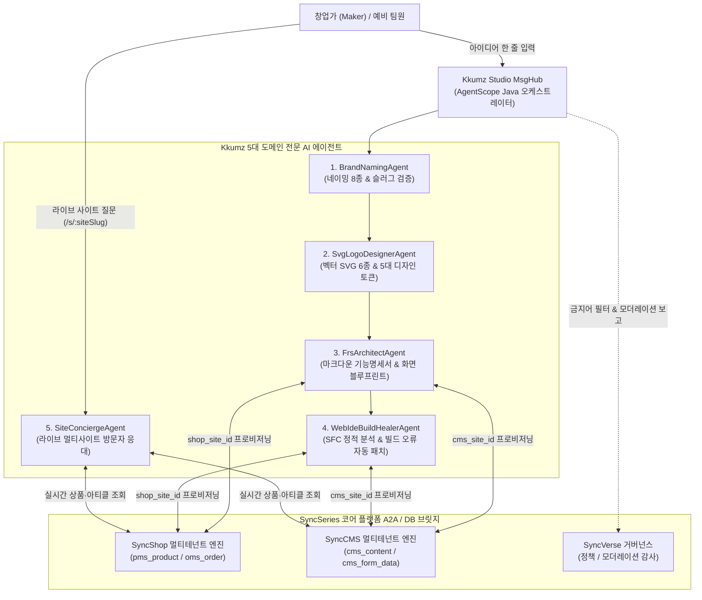

# Kkumz (꿈즈) — AI 에이전트화 및 A2A 자율 연동 아키텍처 (AI Agentization Plan)

- **문서 경로**: `services/kkumz/doc/ai/00_AI_Agentization_Plan.md`
- **표준 프레임워크**: **AgentScope Java (`io.agentscope:agentscope-harness`)**
- **상위 참조 문서**:
  - [`../../../docs/00_SyncSeries_통합_동작방식_및_제품군_연동_가이드.md`](../../../docs/00_SyncSeries_통합_동작방식_및_제품군_연동_가이드.md)
  - [`../../../docs/02_dev/01_agent_specifications.md`](../../../docs/02_dev/01_agent_specifications.md)
  - [`../../../docs/02_dev/02_mcp_api_protocol.md`](../../../docs/02_dev/02_mcp_api_protocol.md)

---

## 1. SyncSeries 생태계 내 Kkumz 에이전트의 역할

**Kkumz (`services/kkumz`)** 는 SyncSeries 생태계의 Vertical Application Service 계층에서 **"창업 아이디어 인큐베이팅 및 멀티테넌트 사이트 프로비저닝 에이전트 허브"** 역할을 수행합니다.

단순히 텍스트나 정적 HTML을 생성하는 독립 도구가 아니라, **SyncShop**(커머스 에이전트) 및 **SyncCMS**(콘텐츠 에이전트)와 직접 연동하여 실제 작동하는 멀티사이트 인스턴스를 자율 구성하고 운영하는 멀티 에이전트 워크벤치입니다.

---

## 2. Kkumz 5대 전문 에이전트 상세 명세

### 2.1 `BrandNamingAgent` (Step 2 브랜드 네이밍 & 도메인 전략 에이전트)
- **기반 프롬프트 원장**: `kkumz_ai_prompt_template` (`step_code = 'BRAND_NAMING_8X'`, `tpl-kkumz-001`)
- **핵심 책임**:
  1. 창업가의 `title`, `summary`, `problem_statement`, `target_audience`, `site_type`을 분석하여 8가지 서로 다른 브랜딩 각도(직관형, 감성 스토리형, 글로벌 확장형 등)의 브랜드명과 태그라인을 생성합니다.
  2. `forbidden_words_json`에 등록된 상표권 침해·부적절 키워드를 사전 필터링합니다.
  3. 각 후보에 대해 URL-Safe 영문 슬러그(`recommended_slug`)를 도출하고 `kkumz_site` 원장과 대조하여 실시간 슬러그 가용성(`slug_available`)을 판정합니다.

### 2.2 `SvgLogoDesignerAgent` (Step 3 벡터 로고 & 디자인 시스템 에이전트)
- **기반 프롬프트 원장**: `kkumz_ai_prompt_template` (`step_code = 'VECTOR_SVG_LOGO_6X'`, `tpl-kkumz-002`)
- **핵심 책임**:
  1. 확정된 브랜드명과 업종 무드에 맞춰 외부 래스터 이미지가 전혀 없는 순수 `<svg viewBox="0 0 120 120">` 코드 6종을 생성합니다.
  2. 멀티사이트 라이브 렌더러(`LiveSiteRendererView.vue`)의 CSS 변수를 즉시 구동할 수 있는 5대 디자인 토큰(`primary`, `secondary`, `accent`, `surface`, `radius`)을 함께 생성합니다.

### 2.3 `FrsArchitectAgent` (Step 4~5 기능명세서 및 화면 블루프린트 설계 에이전트)
- **기반 프롬프트 원장**: `kkumz_ai_prompt_template` (`step_code = 'FRS_SPEC_MARKDOWN'`, `tpl-kkumz-003`)
- **핵심 책임**:
  1. 사이트 유형(`COMMERCE`, `CMS_SITE`, `HYBRID`)에 따라 필요한 SyncShop 상품/구독/결제 모델과 SyncCMS 아티클/리드 폼 구조를 정의한 마크다운 기능명세서를 작성합니다.
  2. 명세서 생성 시마다 `kkumz_idea_version`에 불변 버전 스냅샷(`v1`, `v2`...)을 기록하여 언제든 이전 기획 상태로 롤백할 수 있게 보장합니다.
  3. 명세서와 1:1로 매핑되는 화면 블루프린트(`kkumz_screen_spec`) 및 SDUI 레이아웃 스키마(`layout_schema_json`)를 생성합니다.

### 2.4 `WebIdeBuildHealerAgent` (Step 6 샌드박스 빌드 검증 및 자율 코드 패치 에이전트)
- **기반 프롬프트 원장**: `kkumz_ai_prompt_template` (`step_code = 'WEBIDE_AI_BUILD_FIXER'`, `tpl-kkumz-004`)
- **핵심 책임**:
  1. `CUSTOM_BUNDLE` 배포 트랙에서 사용자가 편집한 `webide_files_json` (`HeroSection.vue`, `CustomStyles.css`, `site.config.json`)의 구문 무결성을 검사합니다.
  2. 샌드박스 빌드 실패(`FAILED`) 발생 시 에러 스택트레이스(`build_log`)와 원본 코드를 대조하여 깨진 `<template>` 태그나 잘못된 스타일 구문을 자율 교정(`trigger_type = 'AI_AUTO_FIX'`)하고 신규 릴리즈 버전으로 재배포합니다.

### 2.5 `SiteConciergeAgent` (멀티사이트 라이브 방문자 응대 에이전트)
- **엔드포인트**: `POST /api/v1/kkumz/sites/{siteSlug}/concierge`
- **핵심 책임**:
  1. 방문자가 접속 중인 `siteSlug`의 기능명세서(`spec_markdown`), 실시간 판매 상품(`sync_shop.pms_product`), 최신 발행 아티클(`sync_cms.cms_content`), 오픈된 팀빌딩 공고(`kkumz_team_recruit`)를 동적 컨텍스트로 로드합니다.
  2. 방문자의 질문 의도(상품 가격·재고, 배송·정기구독, 브랜드 스토리, 팀원 합류 지원)를 파악하여 해당 브랜드 고유의 톤앤매너로 즉시 응대합니다.

---

## 3. 거버넌스 및 안전장치 (Guardrails & HITL)

1. **DB 기반 프롬프트 및 금지어 실시간 제어**:
   - 모든 에이전트의 시스템 프롬프트, Temperature, 금지어 필터는 코드에 고정되지 않고 `kkumz_ai_prompt_template` 테이블에서 관리되며, 운영자가 `/studio/prompts` 화면에서 즉시 제어할 수 있습니다.
2. **모더레이터 HITL (Human-in-the-Loop) 개입**:
   - 사용자 신고(`kkumz_moderation_report`)가 접수된 사이트나 모집 공고는 모더레이터(`role_moderator`)가 `/community/moderation` 화면에서 심사 후 단일 트랜잭션으로 사이트를 즉시 정지(`SUSPENDED`)시킬 수 있습니다.
