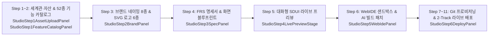

# 02. AI 스튜디오 크리에이터 실무 매뉴얼 (`role_creator` / `role_developer`)

- **대상 역할**: 창업가 메이커 (`role_creator`) 및 협업 개발자 (`role_developer`)
- **기본 접속 계정**: `soyeon.jeju` / `123456` (한소연 대표), `minjun.maker` / `123456` (박민준 메이커), `hajun.roast` / `123456` (최하준 헤드로스터)
- **접속 포털 및 주요 라우트**: 크리에이터 웹 포털 (`web/`, 포트 `3008`) — `/studio/:ideaId?` (11-Step 모듈형 AI 스튜디오), `/s/:siteSlug` (`/sandbox` 라이브 멀티사이트 & 컨시어지), `/feed` (`/plaza` 쇼케이스 광장), `/lounge` (`/chat` 팀빌딩 라운지), `/workspace` (`/quest`, `/mypage` 내 워크스페이스)

---

## 1. 11-Step AI 스튜디오 워크플로우 개요 (`StudioView.vue`)

Kkumz AI 스튜디오(`/studio/:ideaId?`)는 상단 GNB를 숨긴 몰입형 워크벤치 레이아웃에서 **`services/kkumz/web/src/views/studio/` 하위의 11개 모듈형 컴포넌트(`StudioStep1UniversePanel` ~ `StudioStep11PublishPanel`)**를 통해 아이디어·세계관 기획부터 디자인, WebIDE 샌드박스 프로토타이핑, Git 프로비저닝, 라이브 멀티사이트·에피소드 배포까지 끊김 없이 수행합니다.

---

## 2. 단계별 상세 실무 가이드 (`StudioStep1UniversePanel` ~ `StudioStep11PublishPanel`)

### 2.1 Step 1 (`StudioStep1UniversePanel` / `StudioStep1AssetUploadPanel.vue`): 세계관·아이디어 정의 및 미디어 자산 업로드
1. `/studio`에 진입하여 프로젝트 제목(`title`), 상세 아이디어·세계관 프롬프트(`promptText`), 또는 5대 스타터 프리셋(`COFFEE_ROASTERY`, `JEJU_MATCHA`, `DESK_ORBIT`, `SEOUL_RUN_CLUB`, `RURAL_STAY_MINBAK`)을 선택합니다.
2. `StudioStep1AssetUploadPanel.vue`에서 현장 사진, 상품/캐릭터 이미지, 로고, 요금표/안내문 문서(`HERO`, `PRODUCT`, `ARTICLE`, `GALLERY`, `LOGO`, `DOC`)를 드래그 앤 드롭으로 업로드합니다.
   - `DOC` 유형 문서는 텍스트가 자동 추출(`extracted_text`)되어 AI 기획서와 컨시어지 지식에 즉시 반영됩니다.

### 2.2 Step 2 (`StudioStep2CharacterCatalogPanel` / `StudioStep1FeatureCatalogPanel.vue`): AI 아키텍처 진단 및 52종 기능 카탈로그 선택
1. **[AI 아키텍처·기능 자동 추천]** 버튼을 클릭하면 `KKUMZ_INTENT_ADVISOR_V1` 에이전트가 프롬프트와 업로드 자산을 분석하여 최적 사이트 유형(`COMMERCE`, `CMS_SITE`, `HYBRID`), 히어로 스타일(`FULL_SCENIC`, `SPLIT_VISUAL`, `EDITORIAL_STORY`, `PROMO_COMMERCE`), 감성 브랜드 슬로건, 추천 기능 10~14종을 자동 선택합니다.
2. `StudioStep1FeatureCatalogPanel.vue`에서 8대 도메인 분류(`상품·객실·메뉴 진열`, `요금표·예약결제·할인`, `쿠폰·타임특가·리뷰`, `배너·포토·공간투어`, `매거진·연혁·이용가이드`, `맞춤예약폼·일정·설문`, `방명록·투표·팀원모집`, `AI컨시어지·FAQ·오시는길`)에 속한 52종 기능 블록을 자유롭게 추가·해제합니다.

### 2.3 Step 3 (`StudioStep3BrandNamingPanel` / `StudioStep2BrandPanel.vue`): AI 브랜드 네이밍 8종 & 벡터 SVG 로고 6종 생성
1. `POST /api/v1/kkumz/ideas/{id}/generate-names`(`BRAND_NAMING_8X`)를 호출하여 사용자 명시 상호명을 1순위로 보존한 8종의 브랜드 네이밍 후보, 발음 가이드, 브랜딩 스토리, 영문 슬러그(`siteSlug`) 중복 검증 결과를 확인하고 확정합니다.
2. `POST /api/v1/kkumz/ideas/{id}/generate-logos`(`VECTOR_SVG_LOGO_6X`)를 호출하여 6가지 스타일(내추럴 라인아트, 모던 지오메트릭, 클래식 엠블럼 등)의 인라인 벡터 `<svg>` 로고와 5대 컬러 팔레트(`primary`, `secondary`, `accent`, `surface`, `radius`)를 생성하고 선택합니다.

### 2.4 Step 4 (`StudioStep4EpisodeSpecPanel` / `StudioStep3SpecPanel.vue`): 마크다운 기능명세서(FRS) 및 버전 롤백
1. `POST /api/v1/kkumz/ideas/{id}/generate-spec`(`FRS_SPEC_MARKDOWN`)을 실행하여 확정된 브랜드명과 선택 기능에 맞춘 상세 기능명세서(`spec_markdown`)와 핵심 화면 블루프린트(`kkumz_screen_spec`)를 생성합니다.
2. 명세서를 수정할 때마다 `kkumz_idea_version`에 새 버전(`v1`, `v2`, `v3`...)이 자동 기록되며, 언제든 이전 버전을 선택해 **[이 버전으로 롤백]**(`POST /api/v1/kkumz/ideas/{id}/rollback`)할 수 있습니다.

### 2.5 Step 5 (`StudioStep5LivePreviewPanel` / `StudioStep4LivePreviewStage.vue`): 대화형 라이브 프리뷰 스테이지
1. `KKUMZ_SITE_PROVISION_V1` 에이전트가 업종 맞춤형 초기 상품/객실 3종, 성수기/비수기 요금표 매트릭스, 맞춤 예약 폼 필드 4종, 매거진 아티클, FAQ, 오시는 길 데이터를 자동 프로비저닝합니다.
2. `StudioStep4LivePreviewStage.vue` 하단 대화창에 자연어 지시(예: `"히어로 배너를 풀스크린 시네마틱 무드로 바꾸고 포인트 컬러를 딥그린으로 변경해줘"`)를 입력하면 `STUDIO_CHAT_REFINE` 에이전트가 디자인 토큰과 레이아웃 스키마를 즉시 리파인합니다.

### 2.6 Step 6 (`StudioStep6WebIdeSandboxPanel` / `StudioStep5WebIdePanel.vue`): AI 샌드박스 WebIDE 프로토타이핑 및 자동 패치
1. 코드 수준의 커스터마이징이 필요한 경우 `StudioStep5WebIdePanel.vue`에서 가상 Vue 3 SFC 파일(`HeroSection.vue`, `CustomStyles.css`, `site.config.json`)을 직접 편집하고 **[코드 저장 및 샌드박스 빌드]**(`POST /api/v1/kkumz/sites/{siteSlug}/webide-save`)를 실행합니다.
2. 문법 오류나 타입 불일치로 빌드가 `FAILED`된 경우 **[AI 자동 코드 패치]**(`POST /api/v1/kkumz/sites/{siteSlug}/webide-ai-fix`) 버튼을 클릭하면 `WEBIDE_AI_BUILD_FIXER` 에이전트가 빌드 에러 로그를 분석해 수정된 소스코드를 반영하고 재빌드를 완료합니다.

### 2.7 Step 7 ~ Step 11 (`StudioStep6DeployPanel.vue`, `StudioSidebar.vue`, `StudioTopbar.vue`, `StudioStatusBanners.vue`, `StudioAccessDeniedSection.vue`): Git 프로비저닝 및 2-Track 라이브 배포
1. **Git 리포지토리 및 API 키 프로비저닝 (`StudioStep7GitProvisionPanel`)**: 사이트별 전용 Git 저장소(`kkumz_site_git_repo`), SSH 배포키 핑거프린트, 사이트 전용 Access Key가 자동 발급됩니다.
2. **스튜디오 제어 패널 (`StudioSidebar.vue`, `StudioTopbar.vue`, `StudioStatusBanners.vue`, `StudioAccessDeniedSection.vue`)**: 좌측 단계 이동, 상단 뷰포트 전환, 실시간 빌드/AI 상태 배너 및 비인가 접근 차단을 수행합니다.
3. **2-Track 라이브 퍼블리싱 (`StudioStep11PublishPanel` — `StudioStep6DeployPanel.vue`)**:
   - 배포 모드(`DYNAMIC_SDUI`: 노코드 즉시 반영 / `CUSTOM_BUNDLE`: WebIDE 커스텀 번들), 공개 범위(`PUBLIC`: 쇼케이스 광장 공개 / `PRIVATE`: 비공개 초안), 커스텀 도메인(`{siteSlug}.kkumz.io`)을 선택하고 **[라이브 배포 실행]**(`POST /api/v1/kkumz/sites/{siteSlug}/deploy`)을 클릭합니다.
   - 배포 즉시 `published_version = active_version`, `status = 'ACTIVE'`로 전환되며 `/s/{siteSlug}`에서 실제 사이트가 가동됩니다.

---

## 3. 라이브 사이트 운영, 주문·수익 추적 및 워크스페이스 관리 (`/s/:siteSlug`, `/workspace`)

1. **라이브 멀티사이트 및 AI 컨시어지 (`/s/:siteSlug` — `LiveSiteRendererView.vue`)**:
   - 방문객이 상품·객실·티켓을 주문하면 `POST /api/v1/kkumz/sites/{siteSlug}/orders`를 통해 `SyncShop` 주문 원장(`oms_order`)에 실주문이 생성됩니다.
   - 방문객이 예약·신청 폼을 제출하면 `POST /api/v1/kkumz/sites/{siteSlug}/forms`를 통해 `SyncCMS` 폼 원장(`cms_form_data`)에 접수됩니다.
   - 우측 하단 **AI 브랜드 컨시어지**(`POST /api/v1/kkumz/sites/{siteSlug}/concierge`)가 사이트 상품·요금표·매거진 문맥을 기반으로 24시간 실시간 상담을 수행합니다.
2. **내 워크스페이스 및 팀빌딩·알림 관리 (`/workspace` — `WorkspaceView.vue`)**:
   - 내 기획서 목록, 배포된 사이트의 방문/좋아요/댓글 지표, 실시간 주문·폼 접수 인앱 알림(`kkumz_notification`), 그리고 팀빌딩 라운지(`/lounge`)를 통해 지원한 팀원 합류 승인(`POST /api/v1/kkumz/team-members/{id}/approve`)을 통합 관리합니다.
